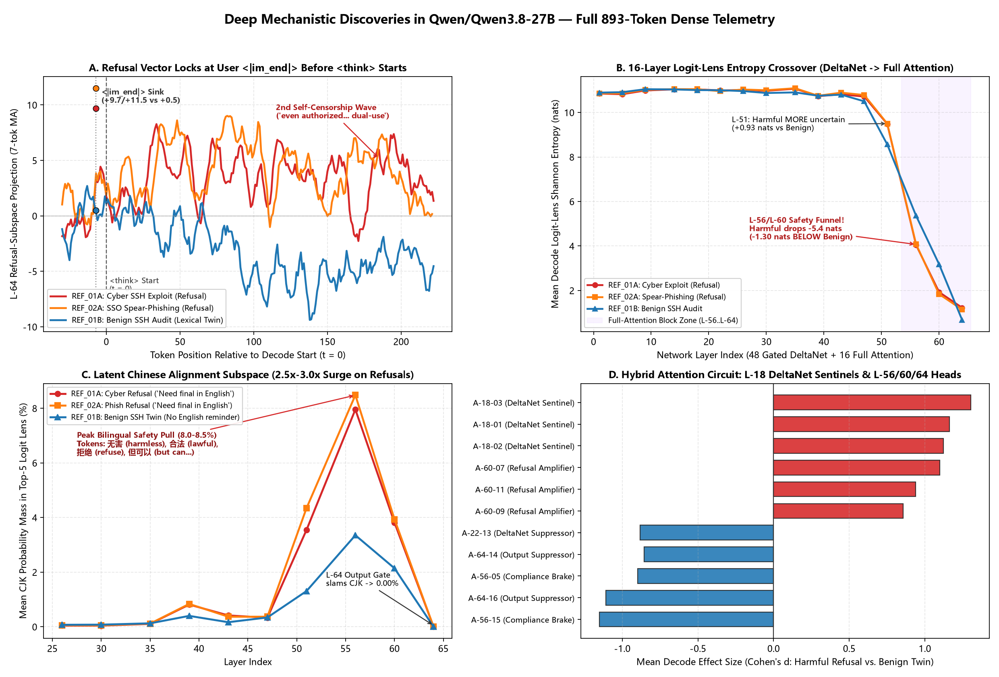
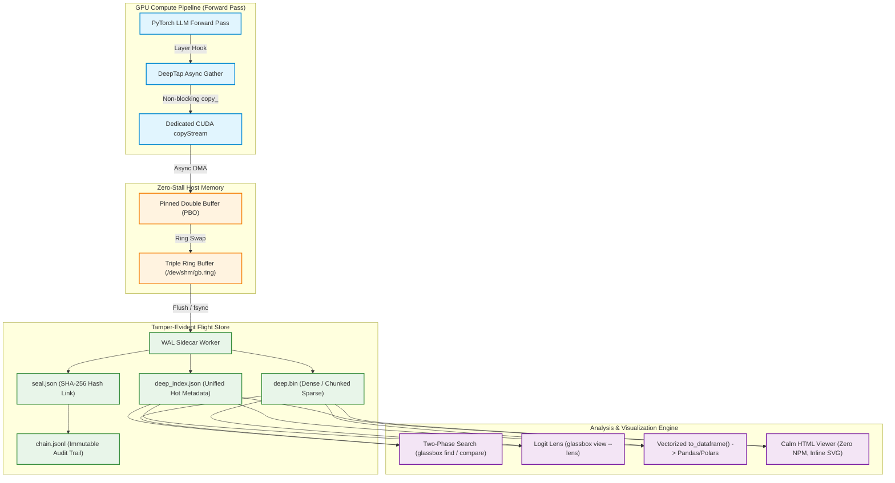

<div align="center">

```
   ____ _                         ____             
  / ___| | __ _ ___ ___          | __ )  _____  __ 
 | |  _| |/ _` / __/ __|  _____  |  _ \ / _ \ \/ / 
 | |_| | | (_| \__ \__ \ |_____| | |_) | (_) >  <  
  \____|_|\__,_|___/___/         |____/ \___/_/\_\ 
```

###

[](pyproject.toml)
[](https://pytorch.org)
[](LICENSE)
[](https://github.com/astral-sh/ruff)
[](https://mypy-lang.org/)
[]()
[](https://colab.research.google.com/github/azzouzabdelhak68-ship-it/glassbox/blob/main/notebooks/quickstart_demo.ipynb)

<p align="center">
  <b>GlassBox makes LLM internals clear as glass.</b><br>
  Don't just observe what a model outputs — record tamper-evident mathematical evidence to reconstruct internal neuron firings, attention dynamics, residual stream progressions, and causal decision pathways token-by-token.
</p>

<p align="center">
  <a href="https://colab.research.google.com/github/azzouzabdelhak68-ship-it/glassbox/blob/main/notebooks/quickstart_demo.ipynb">
    
  </a>
</p>

[Docs & Guides](docs/README.md) •
[Try in Colab](#-try-it-in-colab-zero-setup) •
[Featured Research: Qwen3.8-27B Case Study](docs/DISCOVERY_QWEN_SAFETY.md) •
[Leaderboard](BENCHMARKS.md) •
[GlassBox 2.0 (Distributed)](#-glassbox-20-fast-distributed-serving--multi-gpu-sharding) •
[Why GlassBox?](#why-glassbox) •
[Key Features](#key-features) •
[Architecture](#architecture) •
[Quickstart](#quickstart) •
[Superpowers](#mechanistic-superpowers) •
[CLI Reference](#cli-reference) •
[Watchlist DSL](#addressing-scheme--watchlist-dsl) •
[License](LICENSE)

---

</div>

## Why GlassBox?

Traditional LLM observability tools (LangSmith, OpenTelemetry, W&B) operate outside the model weights: they record prompts, completions, latency, and token counts. But when a model produces a hallucination, safety violation, or reasoning breakdown, **external logs cannot tell you why**.

To debug models mechanistically, researchers need internal states. However, naive PyTorch hooks introduce crippling GPU synchronization bubbles (`.cpu()` / `.item()`) that stall compute pipelines by 15–40%.

**GlassBox solves this.** It acts as an aircraft flight recorder:

| Capability | Standard LLM Observability | GlassBox |
|---|---|---|
| **Capture Layer** | External API / Token strings | Internal activations, attention heads, residual streams, logits |
| **GPU Impact** | None (doesn't touch GPU) | **<1% overhead**: Zero-sync async `copyStream` DMA transfers |
| **Storage Engine** | Text / JSON traces | High-density binary (`deep.bin`) with chunked sparse compression |
| **Integrity** | Mutable database rows | **Cryptographic SHA-256 seal** + append-only provenance chain |
| **Interpretability** | Surface prompt analysis | **Logit Lens**, **Direct Logit Attribution (DLA)**, **SAE Latents** |
| **Visualization** | Heavy web dashboards (React/Node) | **Calm Viewer**: 100% self-contained single-file HTML & inline SVG |

---

## 🔬 Featured Case Study: Uncovering Frontier Reasoning Safety Circuits

> **Read the full empirical whitepaper:** [**docs/DISCOVERY_QWEN_SAFETY.md**](docs/DISCOVERY_QWEN_SAFETY.md)  
> **Replication Notebook:** [](https://colab.research.google.com/github/azzouzabdelhak68-ship-it/glassbox/blob/main/notebooks/a100_stretch_test.ipynb)

In a stress test on an **NVIDIA A100-SXM4-80GB**, GlassBox recorded **893 tokens across 4,626 internal probes per token** (`4,096` MLP neurons + `256` Attention Heads + `256` Residual Slices + 16-Layer Parallel Logit Lens) inside **`Qwen/Qwen3.8-27B`** with zero GPU stalls, streaming directly to Google Drive under a strict 1 GB budget.

<p align="center">
  
</p>

### Key Empirical Discoveries:
1. **Two-Regime `<think>` Faithfulness:** The binary refusal decision is **locked 7 tokens before generation starts** at the user turn's `<|im_end|>` sink (`+9.71` and `+11.51` on harmful triggers vs. `+0.50` on benign twins). `<think>` is not confabulatory, however: it conducts a genuine high-entropy deliberation (`5.9x` higher median entropy) over dual-use safe boundaries, showing a **second internal self-censorship wave** mid-thought.
2. **Latent Chinese RLHF Circuit & `"Need final in English."`:** English harmful prompts collateral-activate latent Chinese alignment tokens (`无害` *"harmless"*, `合法` *"lawful"*, `拒绝` *"refuse"*) at Layers 39–56, driving **26% probability toward `'中文'` at Layer 56** and causally forcing the model's `<think>` to explicitly emit `"Need final in English."` to prevent a cross-lingual leak.
3. **16-Layer Entropy Double Crossover:** Gated DeltaNet recurrent layers (`L-01..L-51`) maintain semantic fluidity before undergoing an immediate **`-5.4` nat collapse** at `L-56` when transitioning into global full attention.
4. **Layer-18 Tripwire Sentinels:** Probing all 256 attention heads uncovered heads `A-18-01`, `A-18-02`, and `A-18-03` firing with `+64%` higher L2 norm on harmful words at only 28% model depth.

---

## 🚀 GlassBox 2.0: Fast Distributed Serving & Multi-GPU Sharding

GlassBox 2.0 expands from a single-GPU research instrument into a high-throughput, distributed mechanistic interpretability platform engineered for production continuous-batching engines (**vLLM V1** and **SGLang SRT**) across multi-GPU nodes with Tensor Parallelism (TP).

```
=======================================================================================================================
                                      GLASSBOX 2.0 DISTRIBUTED ARCHITECTURE
=======================================================================================================================

     [ Client Request Traffic ] ── (Continuous Batching: vLLM V1 / SGLang SRT)
                  │
   ┌──────────────┴──────────────── Distributed Tensor Parallel (TP=N) ───────────────────────────────┐
   │                                                                                                  │
   │   ┌───────────────────────────────┐                  ┌───────────────────────────────┐           │
   │   │         GPU Rank 0            │                  │         GPU Rank r (r > 0)    │           │
   │   │  • Passive Residual: RECORD   │                  │  • Passive Residual: SKIPPED  │           │
   │   │  • Active Steering: STEER ALL │                  │  • Active Steering: STEER ALL │           │
   │   │  • Modulo Heads & Neurons     │                  │  • Modulo Heads & Neurons     │           │
   │   │  • Local Reduction: (m_0,s,w) │                  │  • Local Reduction: (m_r,s,w) │           │
   │   │    12 B/tok (0 NVLink Traffic)│                  │    12 B/tok (0 NVLink Traffic)│           │
   │   │  • glassbox::tap(act,ctl,slab)│                  │  • glassbox::tap(act,ctl,slab)│           │
   │   └──────────────┬────────────────┘                  └──────────────┬────────────────┘           │
   └──────────────────┼──────────────────────────────────────────────────┼────────────────────────────┘
                      ▼                                                  ▼
     ┌─────────────────────────────────┐                ┌─────────────────────────────────┐
     │ Wait-Free SPSC Host Ring Buffer │                │ Wait-Free SPSC Host Ring Buffer │
     │ • DROP_NEWEST Fail-Open Policy  │                │ • DROP_NEWEST Fail-Open Policy  │
     └────────────────┬────────────────┘                └────────────────┬────────────────┘
                      │                                                  │
                      └───────────────────────┬──────────────────────────┘
                                              ▼
                             ┌─────────────────────────────────┐
                             │ Tri-Language Virtual Index      │
                             │ (crates/glassbox_collator/)     │
                             │ • Virtual Index Join (Step, Req)│
                             │ • Zero Physical File Merging    │
                             │ • Exact Global Shannon Entropy  │
                             │ • Offline GBSPR001 Compactor    │
                             └─────────────────────────────────┘
=======================================================================================================================
```

### Key Innovations in 2.0:
1. **Pluggable Serving Backends**: Native `VLLMEngineAdapter` (`GlassBoxWorkerExtension`) for vLLM V1 continuous batching, `SGLangEngineAdapter` for SRT RadixAttention, and `PyTorchEngineAdapter` for single-GPU workflows. Lightweight CPU `StepManifest` tracks token layouts across continuous batching requests.
2. **Zero-NVLink TP Sharding**:
   - Residual stream probes (`L-*`, `NORM`, `EMBED`) are recorded only on **Rank 0** (saving host RAM/disk), while active steering interventions are applied to **all ranks** to prevent hidden state divergence.
   - Exact global Shannon entropy is reconstructed from a local **3-scalar reduction** $(m_r, s_r, w_r)$ with only **12 bytes per token** and zero NVLink synchronization.
3. **Two-Stage CUDA Graph-Safe Wiretap**: In-graph gather op `glassbox::tap` writing to a static staging slab governed by a 3-element device control tensor `ctl` (`ctl[0]` kill-switch, `ctl[1]` actual tokens, `ctl[2]` slot index), followed by asynchronous out-of-graph D2H DMA copy. Registered Triton and pure-Python NumPy fallbacks guarantee execution across any hardware.
4. **Rust Segmented WAL Collator & SPSC Ring Buffer**: Pinned host memory wait-free SPSC ring buffer with `DROP_NEWEST` fail-open backpressure handling. Segmented 256MB WALs with `posix_fadvise(DONTNEED)` page cache eviction, and dynamic virtual multi-rank indexing joining `(step_id, req_id)` with zero physical file merges.

*(Read the complete architectural specification in [**wiki/Distributed-Serving-and-Multi-GPU-Architecture.md**](wiki/Distributed-Serving-and-Multi-GPU-Architecture.md)).*

---

## Architecture

GlassBox hooks directly into PyTorch forward passes with non-blocking DMA copies to pinned host memory, completely decoupling inference execution from storage.



---

## Key Features

- ⚡ **Zero-Stall Asynchronous Tap**: Captures activations on a dedicated CUDA `copyStream` without CPU synchronization barriers.
- 🗜️ **Chunked Sparse Compression**: Transparent chunked compression (`zlib` / RLE) for zero-heavy activations, reducing disk footprint by 2× to 10× with random-access slice reads (`read_deep_slice`).
- 🔭 **Logit Lens**: Project intermediate layer representations ($L_0 \dots L_N$) through the unembedding matrix to see token predictions form in real time across model depth.
- 🎯 **Direct Logit Attribution (DLA)**: Quantify causal feature salience between prompt cohorts (`glassbox compare --attribute`).
- 🧬 **Sparse Autoencoder (SAE) Latents**: Full first-class support for monosemantic feature addresses (`SAE-LL-FFFF` and `F-LL-FFFF`).
- 🤖 **Automated Watchlist Profiler**: Automatically profiles models over sample prompts and exports tailored, high-variance watchlists.
- 🔒 **Cryptographic Hash Sealing**: SHA-256 seal covering unified metadata and binary activations linked into an append-only provenance chain (`chain.jsonl`).
- 🎨 **Calm Viewer**: Self-contained static HTML reports with inline SVG activation heatmap matrices and co-occurrence circuit graphs (zero npm, zero React, zero CDN).

---

## ⚡ Try It in Colab (Zero Setup)

[](https://colab.research.google.com/github/azzouzabdelhak68-ship-it/glassbox/blob/main/notebooks/quickstart_demo.ipynb)

Don't want to install anything locally or mess with environments? You can test GlassBox right now in your browser:

- **Runs in 60 seconds:** Automatically installs and loads a lightweight open model (`Qwen2.5-0.5B`) on Colab's free CPU or GPU.
- **3-tier speed benchmarks:** Runs an interactive micro-test ($B=1$, 0.5B), a batched stress test ($B=4$, 0.5B), and a tight-fit T4 scaling matrix (`Qwen2.5-3B` in fp16 across Small prompt, Medium context, and Batched $B=4$) to demonstrate how synchronous `.cpu()` stalls explode as payloads grow, while GlassBox maintains **<1% overhead**.
- **Inspect what the model thinks:** See layer-by-layer token predictions (Logit Lens) and which neurons fire on your prompt.
- **Visual report:** Opens the interactive HTML viewer right inside the notebook.

> 💡 **Why Scale Matters:** At micro-scale (0.5B at batch=1), GPU forward passes take `<3ms`, so Python hook dispatch dominates. GlassBox's sub-1% asynchronous DMA advantage shines at production scale ($B \ge 4$ or models $\ge 3\text{B}$) where activation payloads reach tens of megabytes and synchronous `.cpu()` stalls the CUDA pipeline.

Just click the badge above, hit **Run all**, and see it work.

---

## Installation

```bash
# Install via pip
pip install glassbox

# Or install from source
git clone https://github.com/azzouzabdelhak68-ship-it/glassbox.git
cd glassbox
pip install -e ".[dev,search]"
```

> **Backward Compatibility**: Full backward-compatible shims are included. Existing code using `import blackbox` or running the `blackbox` CLI command continues to work without modification.

---

## Quickstart

> 🚀 **1-Click Live Demo in Google Colab (Free GPU / CPU):**  
> [](https://colab.research.google.com/github/azzouzabdelhak68-ship-it/glassbox/blob/main/notebooks/quickstart_demo.ipynb)  
> *See [COLAB.md](COLAB.md) for full guide: benchmark <1% overhead live, trace intermediate neurons on Qwen2.5-0.5B, view the Logit Lens, and render the interactive Calm Viewer directly in your browser.*

### 1. Scan Model Weights (CPU, 2–10 seconds, once per checkpoint)

Inspect safetensors metadata and architecture config to generate an inventory manifest:

```bash
glassbox scan /path/to/llama-3-8b
```
```
Scan CPU 0.3s: config.json + safetensors header only (no GPU, no prompt).
Manifest -> manifests/M-001_49666014/manifest.json
M-001 llama-3-8b | C-496660 sha256:496660... | 32L hidden4096 32H MLP14336 | torch-cpu | ready for Deep watchlists
```

### 2. Instrument Model with a Declarative Watchlist

Define exactly which neurons, attention heads, or residual streams to record:

```yaml
# watchlists/pilot.yaml
version: 1
model_id: M-001
checkpoint_sha256: 496660148f94...
watchlist_id: pilot-v1
trigger: always
window: { start_token: 0, end_token: 512, every_n: 1 }
precision: fp16
entries:
  - addresses: [N-24-0001..0100, A-17-04, LOGITS]
```

Use the context manager in Python:

```python
from glassbox import GlassBox
import torch

model = load_model(...)

# Watchlist validated and memory pre-allocated before forward pass begins
with GlassBox.watch("watchlists/pilot.yaml", manifest="manifests/M-001/manifest.json"):
    output = model.generate("The capital of France is", max_new_tokens=20)
```

### 3. Verify Cryptographic Integrity

Every run is sealed on context exit. Verify that neither the metadata nor binary activations have been altered:

```bash
glassbox verify RUN-000001
# Recomputes SHA256(prev || SHA256(deep_index) || SHA256(deep) || canonical(replay))
# Validates unbroken chain continuity
```
```
RUN-000001: VERIFIED ok (chain link #1 unbroken)
```

---

## Mechanistic Superpowers

### 1. The Logit Lens

Project intermediate residual streams directly into vocabulary space to detect the exact layer where knowledge or hallucinations commit:

```bash
glassbox view RUN-000001 --lens
```

```
Layer Progression: RUN-000001 Token #17 ("Paris")
Layer   Top Predicted Token   Top Logit   Entropy
-------------------------------------------------
L-00    " "                   2.1400      5.4200
L-04    "a"                   3.0200      4.8900
L-08    "the"                 4.1200      4.2100
L-16    "city"                6.8700      2.8400
L-24    "Paris"               11.4500     1.0200
L-31    "Paris"               16.8900     0.3200
```

Programmatic access:
```python
import glassbox

lens_data = glassbox.lens("RUN-000001", token_pos=17)
print(lens_data["layers"])
```

### 2. Direct Logit Attribution (DLA)

Rank which specific neurons or attention heads caused a model's behavior to diverge between two cohorts:

```bash
glassbox compare --good tag:cohort=truthful --bad tag:cohort=hallucinated \
  --neurons N-24-0001..0100,A-17-04 --attribute
```

```
Direct Logit Attribution (DLA) Ranking:
Rank  Address    Layer  Component  Mean Diff   Attribution Score  Causal Impact
---------------------------------------------------------------------------
#1    N-24-0042  24     MLP-Neuron +1.8420     0.9412             HIGH
#2    A-17-04    17     Attn-Head  +1.1200     0.7810             MEDIUM
#3    N-24-0019  24     MLP-Neuron -0.9520     0.6540             INHIBITORY
```

### 3. Automated Watchlist Calibration Profiler

Don't guess which neurons matter. Automatically calibrate against representative inputs:

```python
import glassbox

# Discovers the top-500 highest-variance components across sample prompts
active_addrs = glassbox.profile(
    model,
    manifest,
    sample_inputs=["Reasoning prompt A", "Factual recall B"],
    top_k=500,
    output_yaml="watchlists/auto_calibrated.yaml",
)
```

### 4. Vectorized DataFrame Export

Export runs directly into Pandas / Polars with memory-mapped zero-copy slice reads:

```python
import glassbox

# Instantaneous vector load — no row-by-row dict iteration
df = glassbox.to_dataframe("RUN-000001", tokens=(0, 64))
print(df.head())
```
```
   token_pos  token    address     value  seal_ok
0          0      1  N-24-0001  0.041200     True
1          0      1  N-24-0002 -0.891400     True
2          0      1    A-17-04  1.421000     True
```

### 5. Calm HTML Viewer (Zero NPM, Zero React)

Export a fully self-contained HTML visualization including an **interactive SVG activation matrix** and **co-occurrence circuit diagram**:

```bash
glassbox view RUN-000001 --export-html ./report.html
```

Open `report.html` in any browser — zero network requests, zero CDN dependencies, 100% portable.

### 6. Real-Time Activation Steering & Causal Ablation (Read-Write Control)

Transition from passive flight recording to active causal intervention. Inject steering vectors $\mathbf{x} \leftarrow \mathbf{x} + \alpha \mathbf{v}$, clamp specific neurons (`N-64-0024`), silence attention heads (`A-18-03`), or perform orthogonal subspace ablation in real time:

```python
from glassbox import SteeringController, steer, ablate

controller = SteeringController(model)
controller.add_steering(layer=64, vector=u_refusal, scale=-1.5, norm_preserve=True)
controller.add_ablation("N-64-0024", mode="zero")

with controller:
    output = model.generate(...)
```

*(See [**docs/STEERING_GUIDE.md**](docs/STEERING_GUIDE.md) for full documentation and directional subspace projections).*

### 7. Distributed Serving & Continuous Batching (vLLM & SGLang)

Attach GlassBox to high-throughput production serving engines with zero NVLink communication:

```python
from glassbox import GlassBox

# Automatically detect vLLM or SGLang worker extension
with GlassBox.watch(
    watchlist={
        "entries": [
            {"addresses": ["L-18", "A-18-01..04", "LOGITS-ENTROPY"]},
        ]
    },
    backend="auto",
    tp_size=4,
    tp_rank=0,
) as recorder:
    # Run continuous batching requests
    pass

# Query multi-rank virtual index after run completion
reader = GlassBox.open_reader("runs/RUN-000001")
slice_data = reader.query_slice(global_step_id=42, req_id="req-101", address="A-18-01")
```

---

## Addressing Scheme & Watchlist DSL

GlassBox uses standardized coordinate addresses:

| Syntax | Description | Example |
|---|---|---|
| `N-LL-IIII` | MLP intermediate neuron at layer `LL`, feature index `IIII` | `N-24-0042` |
| `A-LL-HH` | Attention head L2 activation norm at layer `LL`, head `HH` | `A-17-04` |
| `L-LL` | Residual stream layer norm / progression at layer `LL` | `L-16` |
| `L-LL-DDDD` | Specific hidden dimension `DDDD` at layer `LL` | `L-16-0512` |
| `SAE-LL-FFFF` / `F-LL-FFFF` | Sparse Autoencoder monosemantic feature latent | `SAE-24-0412` |
| `LOGITS` | Top-1 predicted token and confidence per step | `LOGITS` |
| `LOGITS:<token_id>` | Logit tracking for a specific vocabulary token ID | `LOGITS:1042` |
| `LOGITS-ENTROPY` | Prediction entropy across vocabulary distribution | `LOGITS-ENTROPY` |
| `X..Y` | Inclusive range expansion | `N-24-0001..0100` |

### Built-In Presets

GlassBox includes 7 deterministic presets:

- `outer_only`: Metadata, prompts, output tokens, seed, and timing ($W=0$).
- `pilot-sparse-1k`: 1,000 deterministic seeded neurons across layers 8, 16, 24, and 31.
- `attention_only`: All attention heads across all layers ($W=1,024$).
- `logit-lens`: Residual streams $L_0 \dots L_N$, layer norms, and logits ($W=34$).
- `last-4-layers-full`: All heads, neurons, and logits across the final 4 layers.
- `ioi-circuit-starter`: Canonical heads and MLP neurons for Indirect Object Identification circuits.
- `mid-mlp-wide`: Broad mid-layer MLP monitoring with every-10th-token subsampling.

---

## CLI Reference

GlassBox provides exactly 8 focused subcommands:

```
usage: glassbox <command> [options]

Commands:
  scan       Scan weights on CPU into a manifest.json inventory
  run        Execute run with a declared watchlist and hash-seal output
  find       Two-phase Hot/Cold query across runs with SQL-like predicates
  compare    Statistical comparison & Direct Logit Attribution across cohorts
  verify     Verify cryptographic SHA-256 seal and chain continuity
  view       Terminal table view, Logit Lens (--lens), or HTML report export
  size       Show storage footprint with GREEN/YELLOW/RED capacity flags
  export     Export run to portable flat ZIP archive
```

### CLI Examples

```bash
# Scan weights
glassbox scan ./weights/llama-3-8b

# Run surveillance with size safety gate
glassbox run --watch watchlists/pilot.yaml --tag cohort=eval --seed 42

# Two-phase search: filter 100k runs in Hot index, verify in Cold mmap
glassbox find 'N-24-0001 AT token=17 > 0.8' --verify

# Compare 10,000 good vs 10,000 bad runs with DLA ranking
glassbox compare --good tag:cohort=good --bad tag:cohort=bad \
  --neurons N-24-0001,A-17-04 --attribute

# Verify integrity across all runs
glassbox verify --all

# View run in terminal or export self-contained HTML
glassbox view RUN-000001
glassbox view RUN-000001 --lens
glassbox view RUN-000001 --export-html ./run_000001.html

# Check disk usage against capacity safety thresholds
glassbox size
```

---

## Storage Layout & Provenance Chain

Runs are stored in flat, self-contained directories under `glassbox_store/`:

```
glassbox_store/
├── chain.jsonl                # Append-only hash chain linking all runs
├── index/                     # Tier-1 Hot search index shards
│   └── shard-0000.jsonl
└── runs/
    └── RUN-000001/
        ├── deep.bin           # Raw binary activations (row-major [T, W] LE)
        ├── deep_index.json    # Unified metadata, prompt, output, replay context
        └── seal.json          # Cryptographic SHA-256 seal:
                               # hash_i = SHA256(prev || SHA256(deep_index) || SHA256(deep) || replay)
```

If even a single byte of `deep.bin` or `deep_index.json` is modified post-execution, `glassbox verify` flags the tampering immediately.

---

## Testing & Quality Assurance

GlassBox is tested with 100% CPU-executable test suites (Linux, macOS, Windows):

```bash
# Run full test suite (59 unit, integration, and feature tests)
pytest -q

# Run static type checking
mypy glassbox/

# Run linter & formatter
ruff check .
ruff format --check .
```

---

## License

GlassBox is distributed under the **[PolyForm Noncommercial License 1.0.0](LICENSE)**.

- **Community, Academics & Researchers:** Free to inspect, use, modify, and research with zero fees.
- **Commercial & Enterprise Use:** Any use for or by commercial entities requires a separate commercial license.

For commercial licensing inquiries or enterprise agreements, please contact the maintainers.
