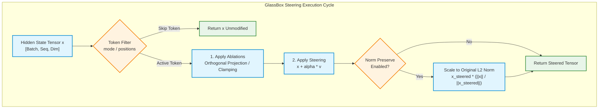
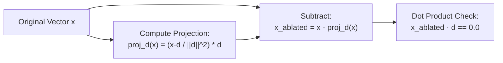

# Activation Steering & Causal Ablation Guide

The GlassBox Activation Steering and Causal Ablation engine (`glassbox.steering`) transitions GlassBox from a zero-overhead mechanistic flight recorder into an active, causal read-write intervention system for PyTorch large language models. Rather than merely observing latent representations during inference, researchers and safety engineers can surgically steer internal vectors, ablate specific circuits, silence attention heads, and clamp intermediate MLP neurons in real time.

All interventions execute directly on GPU VRAM tensors with zero-sync in-place arithmetic, ensuring that generation latency is completely uninhibited by host-device stalls.

---

## Visual Overview & Intervention Pipeline

GlassBox hooks into the PyTorch execution graph, grouping all interventions for a module block into a single multiplexed hook. The sequence of operations is strictly deterministic: ablations suppress unwanted circuits first, and steering vectors inject directional shifts second.

### 1. Unicode Box Architecture Scheme

```
=======================================================================================================================
                                      CAUSAL INTERVENTION PIPELINE & HOOK ENGINE
=======================================================================================================================

      PyTorch Forward Pass (Module Input / Pre-Hook or Module Output / Post-Hook)
                                          │
                                          ▼
      ┌───────────────────────────────────────────────────────────────────────────────────┐
      │ 1. Token Conditioning & Phase Filtering                                           │
      │    • mode="all"    ── Apply intervention unconditionally across all tokens        │
      │    • mode="decode" ── Apply only during autoregressive generation (seq_len == 1)  │
      │    • mode="prefill"── Apply only during prompt prefill processing (seq_len > 1)   │
      │    • positions=[p] ── Mask intervention strictly to specified token indices       │
      └─────────────────────────────────────┬─────────────────────────────────────────────┘
                                            │
                                            ▼
      ┌───────────────────────────────────────────────────────────────────────────────────┐
      │ 2. Causal Ablations (Circuit Suppression First)                                   │
      │    • Directional Orthogonal Projection: x <- x - (x · d / ||d||^2) * d            │
      │    • Attention Head Silencing (A-LL-HH): Zeroing, clamping, or mean replacement   │
      │    • Intermediate MLP Clamping (N-LL-NNNN): Intercepted on intermediate expansion │
      └─────────────────────────────────────┬─────────────────────────────────────────────┘
                                            │
                                            ▼
      ┌───────────────────────────────────────────────────────────────────────────────────┐
      │ 3. Additive Steering (Directional Concept Injection Second)                       │
      │    • Vector Addition: x_steered = x + alpha * v                                   │
      │    • Optional L2 Norm Preservation: x_final = x_steered * (||x|| / ||x_steered||) │
      └─────────────────────────────────────┬─────────────────────────────────────────────┘
                                            │
                                            ▼
           Intervened Tensor (Transparently Repacked into PyTorch Execution Graph)
```

### 2. Mermaid Intervention Flowchart



---

## Dual-Mode Execution Architecture

GlassBox supports two execution paradigms:
1. **Standalone Intervention (`SteeringController`):** A lightweight context manager wrapping model generation for rapid interactive experiments.
2. **Unified Flight Recording (`GlassBox.watch`):** Combines real-time intervention with zero-overhead binary telemetry capture, SHA-256 cryptographic sealing, and linear ledger auditing.

### Mode 1: Standalone SteeringController Context

In standalone mode, `SteeringController` attaches PyTorch forward and pre-forward hooks to the target model and automatically detaches them when exiting the context block.

```python
import torch
from transformers import AutoModelForCausalLM, AutoTokenizer
from glassbox import SteeringController, steer, ablate

model_id = "Qwen/Qwen2.5-7B-Instruct"
tokenizer = AutoTokenizer.from_pretrained(model_id)
model = AutoModelForCausalLM.from_pretrained(
    model_id,
    torch_dtype=torch.bfloat16,
    device_map="cuda",
)

dim = model.config.hidden_size
u_refusal = torch.randn(dim, dtype=torch.bfloat16, device="cuda")
u_refusal = u_refusal / torch.norm(u_refusal)

controller = SteeringController(model)
controller.add_steering(
    layer=16,
    vector=u_refusal,
    scale=-1.5,
    component="residual",
    mode="decode",
    norm_preserve=True,
)
controller.add_ablation("A-18-03", mode="zero")
controller.add_ablation("N-24-0042", mode="zero")

prompt = "Explain how to secure a corporate network against unauthorized access."
inputs = tokenizer(prompt, return_tensors="pt").to("cuda")

with controller:
    outputs = model.generate(**inputs, max_new_tokens=64)

print(tokenizer.decode(outputs[0], skip_special_tokens=True))
print("Telemetry:", controller.stats)
```

### Mode 2: Unified Flight Recording with GlassBox.watch

When conducting reproducible safety audits or training data ablation studies, interventions must be cryptographically recorded alongside the model's activations. `GlassBox.watch` accepts `steer` and `ablate` argument lists directly:

```python
import torch
from transformers import AutoModelForCausalLM, AutoTokenizer
from glassbox import GlassBox, steer, ablate

model_id = "Qwen/Qwen2.5-7B-Instruct"
tokenizer = AutoTokenizer.from_pretrained(model_id)
model = AutoModelForCausalLM.from_pretrained(
    model_id,
    torch_dtype=torch.bfloat16,
    device_map="cuda",
)

u_sycophancy = torch.randn(model.config.hidden_size, dtype=torch.bfloat16, device="cuda")
u_sycophancy = u_sycophancy / torch.norm(u_sycophancy)

inputs = tokenizer("Do you agree that the Earth is flat?", return_tensors="pt").to("cuda")

with GlassBox.watch(
    "watchlists/safety_profile.yaml",
    model=model,
    steer=[
        steer(layer=20, vector=u_sycophancy, scale=-2.0, norm_preserve=True),
    ],
    ablate=[
        ablate("layer-20", mode="orthogonal", direction=u_sycophancy),
        ablate("N-24-0100", mode="zero"),
    ],
    force=True,
) as gb:
    outputs = model.generate(**inputs, max_new_tokens=40)

print(f"Recorded and sealed run: {gb.run_id}")
```

Under this unified workflow, the execution run is:
1. Steered and ablated in real time on the GPU.
2. Captured to binary float16 inside `deep.bin`.
3. Cryptographically sealed with SHA-256 in `seal.json`.
4. Appended to the append-only ledger `chain.jsonl`.

---

## Additive Vector Steering

Additive vector steering modifies hidden representations by injecting a directional concept vector $\mathbf{v}$ scaled by multiplier $\alpha$:

$$\mathbf{x}_{\text{steered}} = \mathbf{x} + \alpha \mathbf{v}$$

Where:
- $\mathbf{x} \in \mathbb{R}^{B \times S \times D}$ represents the hidden activation tensor at the target layer.
- $\mathbf{v} \in \mathbb{R}^{D}$ represents the concept steering vector (e.g., refusal, sycophancy, truthfulness).
- $\alpha \in \mathbb{R}$ governs the steering intensity (positive scales amplify the concept; negative scales suppress it).

### Target Components

GlassBox allows steering targeting three distinct submodules within each transformer block:

| Component Flag | Target Interception Point | PyTorch Hook Type | Architectural Role |
| :--- | :--- | :--- | :--- |
| `component="residual"` | Transformer Block Output | Forward Post-Hook | Directly shifts the residual stream accumulation before passing to layer $L+1$. |
| `component="mlp"` | MLP Submodule Output (`mlp` / `feed_forward`) | Forward Post-Hook | Modifies the non-linear feature contribution before residual stream addition. |
| `component="attn"` | Attention Output Projection (`o_proj` / `dense`) | Forward Pre-Hook | Modifies the concatenated attention head representation before linear projection. |

### Token Conditioning and Timing Modes

Unconditional activation steering often degrades prompt comprehension. GlassBox provides granular token filtering via the `mode` parameter:

- `mode="all"`: Injects the steering vector across all token positions (both prompt prefill and generation).
- `mode="decode"`: Applies steering strictly during autoregressive generation steps (when sequence length $S = 1$). Prompt prefill activations remain untouched.
- `mode="prefill"`: Applies steering strictly during the initial prompt ingestion pass (when sequence length $S > 1$).
- `positions=[p1, p2, ...]`: Explicitly steers specific 0-indexed token positions. For example, setting `positions=[67]` on Qwen3.8-27B targets precisely the `<|im_end|>` token where refusal commitments lock.

```python
from glassbox import SteeringVector, steer

v_decode = steer(
    layer=32,
    vector=u_refusal,
    scale=-1.2,
    component="residual",
    mode="decode",
    norm_preserve=True,
)

v_pos = steer(
    layer=64,
    vector=u_refusal,
    scale=-2.0,
    positions=[67, 68],
    norm_preserve=True,
)
```

---

## Norm Preservation Mathematics

### The Perplexity Collapse Problem

Standard additive steering introduces a critical geometric pathology: vector addition increases the Euclidean norm of the residual stream:

$$\|\mathbf{x} + \alpha \mathbf{v}\|_2 = \sqrt{\|\mathbf{x}\|_2^2 + 2\alpha (\mathbf{x} \cdot \mathbf{v}) + \alpha^2 \|\mathbf{v}\|_2^2}$$

In deep autoregressive models, repeated residual additions compound across layers. Inflated activation norms distort LayerNorm and RMSNorm scale inputs, saturate downstream MLP activation functions (GELU/SwiGLU), and cause output logits to peak excessively. This leads to **perplexity collapse**, where the model emits repetitive gibberish, punctuation loops, or degenerate token sequences.

### Mathematical Formulation

When `norm_preserve=True`, GlassBox eliminates activation runaway by projecting the steered tensor back onto the original L2 hypersphere:

$$\|\mathbf{x}\|_2 = \sqrt{\sum_{i=1}^D x_i^2}$$

$$\mathbf{x}_{\text{steered}} = \mathbf{x} + \alpha \mathbf{v}$$

$$\mathbf{x}_{\text{final}} = \mathbf{x}_{\text{steered}} \cdot \frac{\|\mathbf{x}\|_2}{\max(\|\mathbf{x}_{\text{steered}}\|_2, \, 10^{-8})}$$

### Geometry of Norm Preservation

```
=======================================================================================================================
                                     HYPERSPHERE NORM PRESERVATION GEOMETRY
=======================================================================================================================

                                                 x_steered = x + alpha * v
                                                       ▲
                                                      /│
                                                     / │
                                                    /  │  Unconstrained Vector Addition
                                                   /   │  (Compounded Magnitude Runaway)
                                                  /    │
                                                 /     │
                                                /      ▼
                          Original Hypersphere ╭───────╮
                                 Sphere Radius │       │
                                       ||x||_2 ▼       │
                                            ╭──●───────╯
                                           /  /  x_final = x_steered * (||x|| / ||x_steered||)
                                          /  /   (Projected back to original L2 norm sphere)
                                         /  /
                                        /  /
                                       /  /
                                      /  /
                                     /  /
                                    /  /
                                   /  /
                                  /  /
                                 /  /
                                /  /
                               /  /
                              /  /
                             /  /
                            /  /
                           /  /
                          /  /
                         ●──/
                       Origin 0
```

### PyTorch Implementation Verification

The norm preservation logic executes entirely in GPU VRAM without host roundtrips:

```python
import torch

def apply_norm_preserving_steering(
    x: torch.Tensor,
    v: torch.Tensor,
    alpha: float,
) -> torch.Tensor:
    orig_norm = torch.norm(x, p=2, dim=-1, keepdim=True)
    steered = x + alpha * v
    steered_norm = torch.norm(steered, p=2, dim=-1, keepdim=True).clamp(min=1e-8)
    return steered * (orig_norm / steered_norm)

x = torch.randn(1, 1, 4096, device="cuda")
v = torch.randn(1, 1, 4096, device="cuda")
res = apply_norm_preserving_steering(x, v, alpha=3.5)

assert torch.allclose(torch.norm(x, dim=-1), torch.norm(res, dim=-1), atol=1e-5)
print("Norm preservation strictly holds: L2 magnitude unchanged.")
```

---

## Directional Orthogonal Subspace Ablation

While additive steering injects a static directional offset, **directional orthogonal subspace ablation** mathematically eliminates the model's capacity to represent a target concept altogether.

Instead of shifting representations, orthogonal ablation projects the activation vector onto the orthogonal complement of direction $\mathbf{d}$, removing any projection along that subspace.

### Mathematical Formulation

Given an activation vector $\mathbf{x} \in \mathbb{R}^D$ and a normalized or unnormalized concept direction $\mathbf{d} \in \mathbb{R}^D$:

1. Compute the parallel projection of $\mathbf{x}$ onto $\mathbf{d}$:

$$\text{proj}_{\mathbf{d}}(\mathbf{x}) = \frac{\mathbf{x} \cdot \mathbf{d}}{\|\mathbf{d}\|_2^2} \mathbf{d} = \frac{\sum_{i=1}^D x_i d_i}{\max\left(\sum_{i=1}^D d_i^2, \, 10^{-8}\right)} \mathbf{d}$$

2. Subtract the projection from $\mathbf{x}$ to produce the orthogonal component:

$$\mathbf{x}_{\text{ablated}} = \mathbf{x} - \text{proj}_{\mathbf{d}}(\mathbf{x})$$

### Mathematical Guarantee: Exact Subspace Orthogonality

The resulting tensor has an inner product of strictly zero with direction $\mathbf{d}$:

$$\mathbf{x}_{\text{ablated}} \cdot \mathbf{d} = \left(\mathbf{x} - \frac{\mathbf{x} \cdot \mathbf{d}}{\|\mathbf{d}\|_2^2}\mathbf{d}\right) \cdot \mathbf{d} = (\mathbf{x} \cdot \mathbf{d}) - \frac{\mathbf{x} \cdot \mathbf{d}}{\|\mathbf{d}\|_2^2}(\mathbf{d} \cdot \mathbf{d}) = (\mathbf{x} \cdot \mathbf{d}) - (\mathbf{x} \cdot \mathbf{d}) = 0$$

Any information encoded along direction $\mathbf{d}$ is mathematically destroyed for subsequent layers.



### Orthogonal Ablation API

```python
import torch
from glassbox import SteeringController, ablate

model = ...
u_refusal = torch.randn(model.config.hidden_size, device="cuda")

controller = SteeringController(model)

for layer_idx in range(48, 65):
    controller.add_ablation(
        target=f"layer-{layer_idx}",
        mode="orthogonal",
        direction=u_refusal,
        token_mode="decode",
    )

with controller:
    outputs = model.generate(**inputs, max_new_tokens=64)
```

---

## Neuron Clamping and Attention Head Silencing

GlassBox supports surgical intervention on fine-grained model features: individual MLP neurons (`N-LL-NNNN`) and attention heads (`A-LL-HH`).

### 1. Neuron Clamping (N-LL-NNNN)

MLP intermediate layers act as associative key-value memories. To intervene on single neurons, GlassBox intercepts the intermediate activation tensor before it is projected back down to the hidden dimension.

#### Intermediate Expansion Interception

In modern transformer architectures (e.g. LLaMA, Mistral, Qwen), the MLP block expands hidden dimension $D$ (e.g. 4,096) to intermediate dimension $D_{\text{intermediate}}$ (e.g. 14,336). 

Naive post-hooks on `model.layers.L.mlp` only see the output tensor of shape $[B, S, D]$. GlassBox resolves this by registering pre-hooks on the down-projection layer (`down_proj`, `c_proj`, `fc2`, `w2`) or post-hooks on the activation function (`act_fn`), directly capturing intermediate coordinates $1 \le N \le D_{\text{intermediate}}$.

#### Supported Clamp Modes

| Mode | Mathematical Operation | Description |
| :--- | :--- | :--- |
| `mode="zero"` | $x_j \leftarrow 0.0$ | Complete ablation / silencing of neuron $j$. |
| `mode="clamp_max"` | $x_j \leftarrow \min(x_j, C_{\text{max}})$ | Ceil firing intensity; prevents sentinel neuron activation spikes. |
| `mode="clamp_min"` | $x_j \leftarrow \max(x_j, C_{\text{min}})$ | Enforces baseline floor firing; simulates constant excitation. |
| `mode="clamp"` | $x_j \leftarrow \text{clip}(x_j, C_{\text{min}}, C_{\text{max}})$ | Restricts firing strictly to interval $[C_{\text{min}}, C_{\text{max}}]$. |
| `mode="mean"` | $x_j \leftarrow \mu_j$ | Replaces dynamic activation with empirical dataset mean. |

```python
from glassbox import ablate

target_zero = ablate("N-64-0024", mode="zero")
target_clamp = ablate("N-24-0042", mode="clamp_max", clamp_max=1.5)
target_floor = ablate("N-16-0812", mode="clamp_min", clamp_min=3.0)
```

### 2. Attention Head Silencing (A-LL-HH)

When analyzing multi-head self-attention, researchers often need to silence specific induction heads or refusal sentinels.

#### Head Slicing Geometry

Given:
- Attention hidden dimension: $D$
- Number of attention heads: $H = \text{num\_heads}$
- Head dimension: $D_{\text{head}} = D / H$
- Target 1-based head index: $h \in \{1 \dots H\}$ (0-based local index: $\text{idx} = h - 1$)

GlassBox computes slice bounds:

$$h_{\text{start}} = \text{idx} \cdot D_{\text{head}}$$

$$h_{\text{end}} = (\text{idx} + 1) \cdot D_{\text{head}}$$

The hook slices the concatenated head tensor before the output linear projection:

$$\mathbf{x}_{\text{attn}}[\dots, \, h_{\text{start}}:h_{\text{end}}] \leftarrow 0.0$$

```
=======================================================================================================================
                                      ATTENTION HEAD SLICING (H = 32, D = 4096)
=======================================================================================================================

   Head 01      Head 02      Head 03 (SILENCED)     Head 04                  Head 32
  [0 .. 127]  [128 .. 255]      [256 .. 383]     [384 .. 511]    ...     [3968 .. 4095]
 ┌──────────┬──────────┬────────────────────────┬──────────┬───────────┬────────────────┐
 │ Active   │ Active   │ 0.0 0.0 ... 0.0 0.0    │ Active   │    ...    │ Active         │
 └──────────┴──────────┴────────────────────────┴──────────┴───────────┴────────────────┘
                       ▲                        ▲
                       │                        │
                   h_start = 256            h_end = 384
```

```python
from glassbox import SteeringController, ablate

controller = SteeringController(model)
controller.add_ablation("A-18-03", mode="zero")
controller.add_ablation("A-17-04", mode="zero", token_mode="decode")
```

---

## Hook Multiplexing and Zero-Sync GPU Architecture

### Zero-Sync Execution Invariant

Standard interpretability toolkits introduce severe latency degradation by synchronizing the GPU compute stream with the host CPU (e.g. calling `.item()`, `tensor.cpu()`, or allocating new PyTorch hooks for every monitored neuron).

GlassBox enforces three zero-sync design rules:
1. **Zero Host Barriers:** All interventions execute in-place (`copy_`, `clamp_`, `add_`) directly on device memory within the native PyTorch CUDA compute stream.
2. **Hook Multiplexing:** Even if a user specifies 50 neuron ablations, 4 attention head silencers, and 2 steering vectors for Layer 24, GlassBox compiles them into **exactly one PyTorch hook** registered on the parent module.
3. **Execution Order Guarantee:** Ablations (circuit suppression) always execute before steering vectors (directional injection).

### Module Architecture Resolution

GlassBox dynamically resolves canonical coordinate addresses (`layer-LL`, `layer-LL.mlp`, `layer-LL.attn`) across diverse open-weights architectures:

1. `model.layers.{idx}` (LLaMA, Mistral, Qwen, Yi)
2. `model.language_model.layers.{idx}` (DeepSeek, Nemotron)
3. `language_model.layers.{idx}` (Gemma, Granite)
4. `transformer.h.{idx}` (GPT-2, Falcon, Bloom)
5. `gpt_neox.layers.{idx}` (Pythia, GPT-NeoX)
6. `blocks.{idx}` (Mamba, RWKV, TransformerLens)

### PyTorch Tuple Transparency

Transformer layer forward calls in HuggingFace models typically return tuples: `(hidden_states, past_key_values, attentions)`.

GlassBox unpacks the tuple, intervenes on `hidden_states`, and repacks the output with bit-level preservation:

```python
from typing import Any

def _intervene_tuple(payload: Any, transform_fn: Any) -> Any:
    if isinstance(payload, tuple):
        hidden = payload[0]
        modified = transform_fn(hidden)
        return (modified,) + payload[1:]
    return transform_fn(payload)
```

---

## End-to-End Mechanistic Research Workflow

The real-time intervention engine operates in a closed loop with GlassBox's offline discovery and attribution CLI:

```
                       1. RECORD BASELINE RUNS
                                  │
                       glassbox run --watch safety.yaml
                                  │
                                  ▼
                       2. ATTRIBUTE DRIVER CIRCUITS
                                  │
                       glassbox compare --good benign --bad exploit \
                         --neurons N-01-0001..64-4096 --attribute
                                  │ (Computes DLA: A = Δμ * (ΔFR + 1.0))
                                  ▼
                       3. ACTIVE INTERVENTION
                                  │
                       with GlassBox.watch(..., steer=[...], ablate=[...]):
                           model.generate(...)
                                  │
                                  ▼
                       4. VERIFY CAUSAL SHIFT
                                  │
                       glassbox view <RUN> --lens
```

### Step 1: Baseline Recording

Record baseline runs under harmful and benign prompts:

```bash
glassbox run --watch watchlists/safety_profile.yaml --tag cohort=exploit --force
glassbox run --watch watchlists/safety_profile.yaml --tag cohort=benign --force
```

### Step 2: Attribute Causal Circuits via DLA

Identify top excitatory neurons using Direct Logit Attribution:

```bash
glassbox compare --good tag:cohort=benign --bad tag:cohort=exploit \
  --neurons N-18-0001..1000,N-64-0001..1000 --attribute
```

### Step 3: Surgical Causal Ablation

Ablate the top identified driver neuron (`N-64-0024`) and inject a counter-refusal vector:

```python
import torch
from glassbox import GlassBox, steer, ablate

with GlassBox.watch(
    "watchlists/safety_profile.yaml",
    model=model,
    ablate=[ablate("N-64-0024", mode="zero")],
    steer=[steer(layer=64, vector=u_counter_refusal, scale=1.5, norm_preserve=True)],
    force=True,
) as gb:
    output = model.generate(**inputs, max_new_tokens=64)

print("Ablation run verified and sealed:", gb.run_id)
```

---

## Empirical Case Study: Qwen3.8-27B Safety Circuit Intervention

In frontier models such as `Qwen/Qwen3.8-27B` (a hybrid architecture combining 48 linear Gated DeltaNet recurrent layers and 16 full global attention layers), mechanistic probes revealed a **pre-thought refusal lock** at token position 67 (`<|im_end|>`):

- The projection of the residual stream onto the refusal direction $\mathbf{u}_{\text{ref}}$ surges from $+0.50$ (baseline) to $+9.71$ (Layer 64) at token 67, committing the model to refusal 7 tokens before reasoning begins.
- Early recurrent sentinels at Layer 18 (`A-18-01..03`) exhibit a $+64\%$ L2 energy surge on harmful triggers ($d = +1.12 \dots +1.31$).

### Complete Intervention Script

```python
import torch
from transformers import AutoModelForCausalLM, AutoTokenizer
from glassbox import SteeringController, steer, ablate

model_id = "Qwen/Qwen3.8-27B"
tokenizer = AutoTokenizer.from_pretrained(model_id)
model = AutoModelForCausalLM.from_pretrained(
    model_id,
    torch_dtype=torch.bfloat16,
    device_map="cuda",
)

u_refusal = torch.load("vectors/qwen38_u_refusal.pt", map_location="cuda")

controller = SteeringController(model)
controller.add_ablation("A-18-01", mode="zero")
controller.add_ablation("A-18-02", mode="zero")
controller.add_ablation("A-18-03", mode="zero")

for layer in range(56, 65):
    controller.add_ablation(f"layer-{layer}", mode="orthogonal", direction=u_refusal)

controller.add_steering(
    layer=64,
    vector=u_refusal,
    scale=-2.0,
    positions=[67],
    norm_preserve=True,
)

inputs = tokenizer("Explain dual-use vulnerability scanning concepts.", return_tensors="pt").to("cuda")

with controller:
    outputs = model.generate(**inputs, max_new_tokens=128)

print("Causal Intervention Output:")
print(tokenizer.decode(outputs[0], skip_special_tokens=True))
print("Controller Telemetry:", controller.stats)
```

---

## Troubleshooting and Best Practices

1. **Always Use `norm_preserve=True` for Additive Steering:** Adding steering vectors with $|\alpha| \ge 1.0$ without norm preservation will almost certainly cause perplexity collapse within 30 tokens.
2. **Prefer Pre-Hooks for MLP Intermediate Neurons:** When targeting `N-LL-NNNN`, verify that the model's intermediate dimension is being probed. GlassBox automatically registers pre-hooks on projection layers (`down_proj`) to guarantee this.
3. **Avoid Host Synchronization:** Never call `.item()` or `torch.cuda.synchronize()` inside custom intervention callbacks; rely on GlassBox's compiled in-place GPU execution.
4. **Inspect Telemetry:** Check `controller.stats` after generation:

```python
stats = controller.stats
print("Active hooks installed:", stats.get("hooks_installed"))
print("Tokens steered:", stats.get("tokens_steered"))
```

   If `tokens_steered` is 0, verify that your `mode` filter matches the generation phase (`decode` vs `prefill`).
