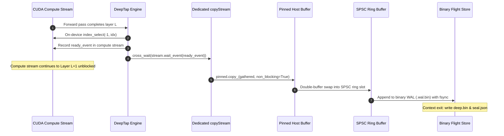
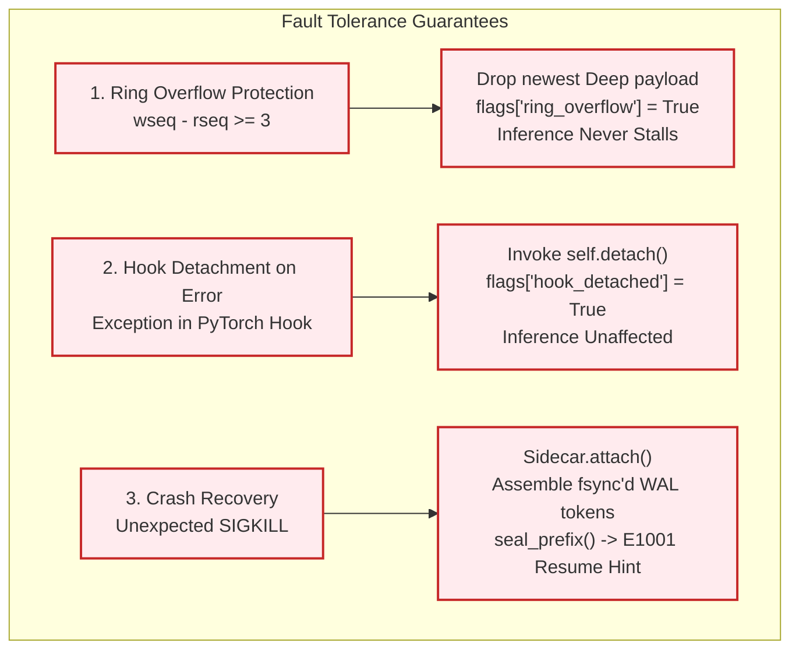
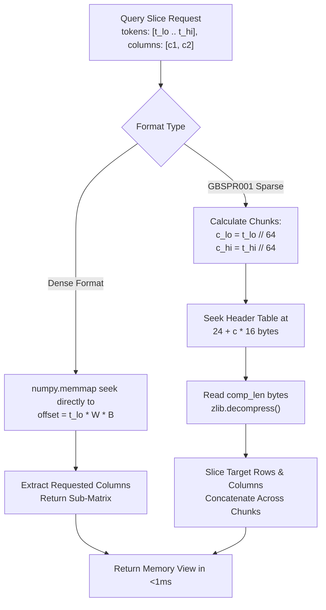

# Architecture & Internals

GlassBox is a zero-overhead mechanistic flight recorder and interpretability instrumentation engine for PyTorch large language models. Traditional LLM observability tools operate exclusively at external system boundaries (capturing prompts, completions, latency, and token consumption). Conversely, academic mechanistic interpretability toolkits rely on naive PyTorch forward hooks that synchronize the CUDA compute stream via `.cpu()` or `.item()` calls, introducing GPU execution bubbles that degrade generation throughput by 15% to 40%.

GlassBox resolves this fundamental trade-off through a decoupled multi-tiered architecture:
1. **Zero-Stall Asynchronous Tap (<1% Overhead):** Captures intermediate activations, attention head projections, residual streams, and output logits onto dedicated CUDA copyStreams using double-buffered pinned host memory (PBO), decoupling forward-pass compute from telemetry storage.
2. **Lockless SPSC Triple-Buffer Ring (`GBRING01`) & Binary WAL:** Features cache-disjoint boundaries between producer and consumer processes, coupled with an append-only binary Write-Ahead Log (`.wal.bin`) for sub-millisecond crash durability.
3. **High-Density Chunked Sparse Binary Storage (`deep.bin`):** Implements an indexed chunked binary format (`GBSPR001`) with zlib compression, providing 2x–10x disk compression while preserving sub-millisecond random-access slice reads (`read_deep_slice`).
4. **Cryptographic Run Provenance via SHA-256 Hash Chaining:** Every execution run is cryptographically sealed via `hash_i = SHA256(prev || SHA256(deep_index) || SHA256(deep) || canonical(replay))` and linked into an append-only linear audit ledger (`chain.jsonl`).
5. **Mechanistic Analysis Engine:** Features a 16-layer parallel Logit Lens (`glassbox.lens`) and Direct Logit Attribution (`glassbox compare --attribute`) to attribute causal drivers across model depth.

---

## Visual Architecture Overview

### System Architecture Scheme

```
=======================================================================================================================
                                      GLASSBOX SYSTEM RUNTIME ARCHITECTURE
=======================================================================================================================

   PyTorch Forward Pass (CUDA Compute Stream 0)
          │
          ├──► [SteeringController] ── (In-Place In-VRAM Causal Intervention: Ablate -> Steer)
          │
          ▼
   [DeepTap Hook Engine] ───────────── (Parent-Module-Only Interception)
          │
          ├──► On-Device Column Selection (index_select in GPU VRAM)
          ├──► ready_event.record(compute_stream)
          │
          ▼
   [Dedicated CUDA copyStream] ─────── (Hardware DMA Engine)
          │
          ├──► stream.wait_event(ready_event) [GPU Hardware Barrier - Host Unblocked]
          ├──► pinned_buffer.copy_(gathered, non_blocking=True)
          │
          ▼
   [Double-Buffered Pinned Memory (PBO)]
          │
          ▼
   [Lockless SPSC Ring Buffer] ─────── (/dev/shm/gb.ring, GBRING01, 33-byte header, Cache-Disjoint)
          │
          ├──► [Binary WAL Sidecar] ── (wal/<RUN-ID>.wal.bin, struct.pack("<i", token) + payload, fsync)
          │
          ▼
   [Storage Engine: $GLASSBOX_DIR/runs/RUN-XXXXXX/]
          ├──► deep.bin               (Chunked Sparse Format GBSPR001, zlib blocks, 64-token chunks)
          ├──► deep_index.json        (Unified Hot Manifest: tokens, prompt, timing, replay)
          ├──► seal.json              (Cryptographic SHA-256 Provenance Seal)
          └──► chain.jsonl            (Immutable Append-Only Ledger, FileLock Protected)
```

### End-to-End Component Flowchart



---

## Non-Blocking DMA Staging and copyStream

### The CUDA Synchronization Bubble Problem

In standard PyTorch LLM instrumentation, capturing an activation matrix during generation requires invoking `.cpu()` or `.item()` inside hook callbacks. When compute operations are executed on the default CUDA stream (`cudaStreamDefault` or stream 0), issuing a synchronous host copy forces a device-to-host synchronization barrier (`cudaStreamSynchronize` / `cudaMemcpy`). This forces the GPU compute pipeline to flush all in-flight warps, wait for PCIe bus transfer completion, and idle the streaming multiprocessors (SMs), degrading token-per-second generation rates by 15%–40%.

```
SYNCHRONOUS HOOK EXECUTION (15% - 40% Overhead):
[Forward L1]──►[cudaMemcpySync (.cpu())]──►[Forward L2]──►[cudaMemcpySync (.cpu())]
                     ▲                           ▲
                     └─ GPU SM IDLE BUBBLE       └─ GPU SM IDLE BUBBLE

GLASSBOX ASYNCHRONOUS DMA PIPELINE (<1% Overhead):
Compute Stream: [Forward L1]─────────────────►[Forward L2]────────────────►[Forward L3]
                     │                             │
                     ▼ ready_event.record          ▼ ready_event.record
copyStream:          [wait_event -> PCIe DMA Copy] [wait_event -> PCIe DMA Copy]
```

### Dedicated copyStream and Double-Buffered Pinned Host Memory

GlassBox eliminates synchronization bubbles by using an asynchronous DMA pipeline implemented in `glassbox/gpu_adapters/nvidia.py` and `glassbox/tap/hooks.py`:

```python
import torch
from typing import Any

def allocate_async_context(parent_modules: list[str], nbytes: int) -> dict[str, Any]:
    ctx: dict[str, Any] = {
        "streams": {},
        "events": {},
        "pinned_buffers": {},
    }
    for parent in parent_modules:
        ctx["streams"][parent] = torch.cuda.Stream()
        ctx["events"][parent] = torch.cuda.Event()
        ctx["pinned_buffers"][parent] = [
            torch.empty(nbytes, dtype=torch.uint8).pin_memory(),
            torch.empty(nbytes, dtype=torch.uint8).pin_memory(),
        ]
    return ctx
```

### Detailed Implementation Mechanics

1. **Pinned Host Memory Allocation:** Pinned host memory buffers are allocated via `torch.empty(nbytes, dtype=torch.uint8).pin_memory()`. Pinned pages are physically locked into host RAM, permitting GPU DMA copy engines to read and write over PCIe without operating system page table faults.
2. **Double-Buffering:** Pinned buffers are organized as a double-buffer (`_HostSlot` 0 and 1). While slot 0 is being read by the host sidecar process, slot 1 is actively receiving the next token's DMA payload, completely eliminating data races during back-to-back token generation steps.
3. **Pre-Constructed Device Indices:** Monitored column indices (`device_idx[parent]`) are pre-constructed on GPU memory as `torch.long` tensors during context initialization, eliminating host-to-device transfers during forward passes.

### Cross-Stream Event Synchronization Barrier

Cross-stream synchronization is orchestrated without host interruption in `glassbox/gpu_adapters/nvidia.py`:

```python
def stage_copy(gathered: Any, pinned: Any, stream: Any = None, event: Any = None) -> None:
    if stream is not None:
        ready_event = event if event is not None else torch.cuda.Event()
        ready_event.record(torch.cuda.current_stream())
        with torch.cuda.stream(stream):
            stream.wait_event(ready_event)
            pinned.copy_(gathered, non_blocking=True)
            if event is not None:
                event.record(stream)
    else:
        pinned.copy_(gathered, non_blocking=True)
```

The synchronization sequence proceeds in four hardware-level steps:
- **Step A (`ready_event.record`):** Places a lightweight hardware event marker into the compute stream immediately after the layer's forward pass completes.
- **Step B (`stream.wait_event`):** Instructs the dedicated `copyStream` to wait until the GPU hardware signals that the marker has completed. This dependency is resolved entirely by the GPU cross-stream hardware scheduler; the host CPU execution thread continues immediately without waiting.
- **Step C (`pinned.copy_`):** The GPU DMA engine schedules an asynchronous PCIe transfer from device memory into the pinned host memory slot.
- **Step D (Independent Forward Progress):** Forward compute operations for subsequent transformer layers proceed in parallel on the primary compute stream while PCIe DMA transfer executes concurrently.

### Parent-Module-Only Hooking and In-VRAM Column Selection

PyTorch forward hooks are registered **only once per parent module** (e.g., `model.layers.0.mlp`), never per individual neuron. For MLP neurons (`N-LL-NNNN`), GlassBox resolves the intermediate expansion layer (`down_proj`, `c_proj`, `fc2`, `w2`), capturing intermediate activations of size $D_{\text{intermediate}}$ (e.g. 14,336) rather than the collapsed hidden dimension (4,096).

Column extraction is performed via on-device `index_select(-1, idx)` (`glassbox/tap/hooks.py`), keeping extraction entirely in GPU VRAM:

```python
def extract_monitored_columns(hidden: torch.Tensor, device_indices: torch.Tensor) -> torch.Tensor:
    if hidden.ndim == 3:
        return torch.index_select(hidden, dim=-1, index=device_indices)
    elif hidden.ndim == 2:
        return torch.index_select(hidden, dim=-1, index=device_indices)
    return hidden
```

### Vectorized Prefill Flushes

During prompt prefill passes where sequence length $S > 1$, activations across all monitored layers are combined on-device into a single contiguous GPU buffer `gpu_mat` using `index_copy_`. 

A single bulk DMA transfer (`full_mat = gpu_mat.to(device="cpu").numpy()`) then transfers the entire sequence to host memory in one PCIe transaction, amortizing driver call overhead across hundreds of tokens.

### Asynchronous On-Device Logits and Entropy Summary

When monitoring output distribution metrics (`LOGITS`, `LOGITS-ENTROPY`), top-5 token IDs and probabilities are computed on-device via `torch.topk` and `torch.softmax`. Detached tensors `(top_vals.detach(), top_ids.detach(), ent_val.detach())` are stored in `_raw_logits_summary` without host synchronization. 

Host CPU float and integer conversions are materialized lazily only when accessing `tap.logits_summary` during run finalization.

---

## Lockless SPSC Triple-Buffer Ring and WAL

For multi-process streaming and crash-resilient persistence, GlassBox implements a memory-mapped Single-Producer Single-Consumer (SPSC) triple-buffer ring located at `/dev/shm/gb.ring` (or Windows `%TEMP%\gb.ring`).

```
=======================================================================================================================
                                      SHARED MEMORY TRIPLE RING (mmap: 33-byte Header)
=======================================================================================================================
[ MAGIC: GBRING01 (8B) | VER (4B) | W (4B) | WRITE_SEQ (8B) | READ_SEQ (8B) | OVERFLOW (1B) ]
                                                   │                 │
                                            Producer-Owned    Consumer-Owned
                                            (append_token)        (poll)
-----------------------------------------------------------------------------------------------------------------------
  Slot 0: [ SLOT_HDR (12B: state, token, nvals) | PAYLOAD (W * B bytes: LE Floats) ]
  Slot 1: [ SLOT_HDR (12B: state, token, nvals) | PAYLOAD (W * B bytes: LE Floats) ]
  Slot 2: [ SLOT_HDR (12B: state, token, nvals) | PAYLOAD (W * B bytes: LE Floats) ]
=======================================================================================================================
                                      │
                                      ▼
                        [Binary WAL: wal/<RUN-ID>.wal.bin]
                 Record: [ token_pos (<i, 4B) | raw_bytes (W * B) ]
                                      │
                                      ▼
                          [Durability fsync_every]
```

### Protocol Specification and Header Layout

The shared memory ring header is exactly 33 bytes packed using format `<8sIIQQ?`:

| Field Offset | Field Name | Type | Size | Description |
| :--- | :--- | :--- | :--- | :--- |
| `0..8` | `magic` | `char[8]` | 8 Bytes | Protocol signature: `b"GBRING01"` (also accepts legacy `b"BBRING01"`). |
| `8..12` | `version` | `uint32` | 4 Bytes | Ring protocol version (`VERSION = 1`). |
| `12..16` | `W` | `uint32` | 4 Bytes | Watched column count $W$. |
| `16..24` | `write_seq` | `uint64` | 8 Bytes | Monotonically increasing producer sequence counter. |
| `24..32` | `read_seq` | `uint64` | 8 Bytes | Monotonically increasing consumer sequence counter. |
| `32..33` | `overflow` | `bool` | 1 Byte | Boolean flag indicating unpolled buffer overflow. |

### Cache-Disjoint SPSC Concurrency Invariant

Producer and consumer processes write to strictly disjoint cache lines:
- The producer (`append_token`) modifies only `write_seq`, `overflow`, and slot payload bytes.
- The consumer (`poll`) modifies only `read_seq` and resets slot headers to `_STATE_EMPTY`.
- Because producer and consumer never write to the same memory addresses, cache line ping-ponging and atomic compare-and-swap (CAS) overhead are eliminated.

### Slot Header Format

Each ring slot begins with a 12-byte header packed using `<III`:
1. `state` (4 Bytes, unsigned int): `_STATE_EMPTY = 0`, `_STATE_WRITING = 1`, `_STATE_READY = 2`.
2. `token` (4 Bytes, unsigned int): Token sequence position.
3. `nvals` (4 Bytes, unsigned int): Number of floats contained ($W$).
Followed immediately by $W \times B$ raw little-endian bytes.

### Binary WAL Format (.wal.bin)

GlassBox eliminates JSON serialization overhead in the flight path. Each Write-Ahead Log entry is binary packed:

$$\text{WAL Entry} = \text{struct.pack}("<i", \, \text{token\_pos}) \mathbin{\Vert} \text{raw\_payload\_bytes}$$

Durability is governed by `fsync_every`:
- `fsync_every=1`: Calls `os.fsync()` after every token for hard crash durability.
- `fsync_every=N`: Batches fsync across $N$ tokens for maximum throughput.

### Fault Tolerance Guarantees

GlassBox enforces three non-negotiable stability invariants:



1. **Ring Overflow Protection:** If the ring fills (all 3 slots occupied and unpolled, `wseq - rseq >= 3`), or host buffer capacity is reached, GlassBox sets `flags["ring_overflow"] = True` and drops the newest activation payload. **Inference execution is never blocked or stalled.**
2. **Automatic Hook Detachment on Error:** If any exception occurs inside an activation hook (e.g., shape mismatch, device OOM), the exception is caught, `self.detach()` is invoked immediately to unhook all modules and restore clean PyTorch execution, and `flags["hook_detached"] = True` is recorded. Inference continues unimpeded, and the host application is never aborted.
3. **Crash Recovery & Prefix Sealing:** If the host process is terminated unexpectedly (`SIGKILL`), `Sidecar.attach(store, run_id)` re-attaches to the uncorrupted binary WAL, assembles all tokens fsync'd prior to the crash, and invokes `seal_prefix()`. The sealed run prefix remains verifiable via `glassbox verify`, returning an E1001 resume hint indicating the exact last durable token position.

---

## Chunked Sparse Binary Storage (deep.bin)

All GlassBox runs reside in a flat directory hierarchy under `$GLASSBOX_DIR` (default `./glassbox_store/`):

```
glassbox_store/
├── chain.jsonl                # Append-only SHA-256 provenance chain
├── chain.jsonl.lock           # Atomic file lock for multi-worker run sealing
├── index/                     # Tier-1 Hot search index shards
│   └── shard-0000.jsonl       # High-throughput candidate filter entries
└── runs/
    └── RUN-000001/
        ├── deep.bin           # Raw binary activations (Dense row-major or Chunked Sparse)
        ├── deep_index.json    # Unified HOT run manifest, pointers, prompt, output, replay
        ├── seal.json          # Cryptographic SHA-256 seal
        └── meta.json          # Cached hot aggregates for fast local re-indexing
```

### Storage Directory Hierarchy

Each run is stored in an isolated subdirectory named after its assigned identifier (`RUN-XXXXXX`). The directory contains:
- `deep.bin`: The binary activation tensor stored in row-major order.
- `deep_index.json`: The unified hot manifest specifying watchlist pointers, column offsets, prompt tokens, generation metrics, and replay configuration.
- `seal.json`: The SHA-256 cryptographic attestation linking this run to the global provenance ledger.
- `meta.json`: Hot aggregate cache for sub-millisecond search indexing.

### Dense Binary Layout

In dense uncompressed mode, activations are stored as a raw, contiguous little-endian binary matrix of shape $[T, W]$:
- Token-major addressing: The value at token $t$ and column index $j$ is located at:

$$\text{Byte Offset} = (t \cdot W + j) \cdot B$$

Where $B$ is precision bytes (`fp32`: 4, `fp16`: 2, `bf16`: 2).

### Precision Encodings and True IEEE bfloat16

GlassBox supports three precisions with hardware-accurate bit fidelity:
- `fp32` ($B = 4$): Standard IEEE 754 single-precision float (`<f4`).
- `fp16` ($B = 2$): Standard IEEE 754 half-precision float (`<f2`).
- `bf16` ($B = 2$): True IEEE bfloat16 representation (`<u2`). 

#### Hardware-Accurate Round-to-Nearest-Even Encoding

Rather than naively truncating lower mantissa bits (which introduces systematic positive directional bias across layers), GlassBox implements true IEEE 754 round-to-nearest-even conversion:

```python
import numpy as np

def encode_bfloat16_rne(arr: np.ndarray) -> np.ndarray:
    f32 = np.ascontiguousarray(arr, dtype=np.dtype("<f4"))
    u32 = f32.view(np.dtype("<u4"))
    nan_mask = np.isnan(f32)
    rounding_bias = np.uint32(0x7FFF) + ((u32 >> np.uint32(16)) & np.uint32(1))
    rounded = np.where(nan_mask, u32 | np.uint32(0x00400000), u32 + rounding_bias)
    encoded = (rounded >> np.uint32(16)).astype(np.dtype("<u2"))
    return encoded
```

### Chunked Sparse Binary Format (GBSPR001)

When compression is enabled (`compression="sparse"`, `"zlib"`, or `"sparse_rle"`), GlassBox formats `deep.bin` according to the `GBSPR001` specification:

```
=======================================================================================================================
                                      CHUNKED SPARSE BINARY FORMAT (GBSPR001)
=======================================================================================================================
HEADER (24 Bytes, <8sIIII):
  [ MAGIC: "GBSPR001" (8B) | VER: 1 (4B) | CHUNK_TOKENS: 64 (4B) | NUM_CHUNKS (4B) | PREC_CODE (4B) ]
-----------------------------------------------------------------------------------------------------------------------
CHUNK INDEX TABLE (NUM_CHUNKS * 16 Bytes, <QII):
  Entry 0: [ OFFSET (uint64, 8B) | COMPRESSED_LEN (uint32, 4B) | UNCOMPRESSED_LEN (uint32, 4B) ]
  Entry 1: [ OFFSET (uint64, 8B) | COMPRESSED_LEN (uint32, 4B) | UNCOMPRESSED_LEN (uint32, 4B) ]
  ...
  Entry C: [ OFFSET (uint64, 8B) | COMPRESSED_LEN (uint32, 4B) | UNCOMPRESSED_LEN (uint32, 4B) ]
-----------------------------------------------------------------------------------------------------------------------
COMPRESSED PAYLOADS (Sequential zlib level-6 blocks):
  [ Chunk 0 (zlib compressed bytes) ][ Chunk 1 ][ Chunk 2 ] ... [ Chunk C ]
=======================================================================================================================
```

#### Binary Header Schema (24 Bytes, `<8sIIII`):
1. `magic` (8 Bytes): `b"GBSPR001"` (also accepts legacy `b"BBSPR001"`).
2. `version` (4 Bytes, uint32): `1`.
3. `chunk_tokens` (4 Bytes, uint32): Number of token rows per chunk (default `64`).
4. `num_chunks` (4 Bytes, uint32): Total chunk count $\lceil T / \text{chunk\_tokens} \rceil$.
5. `prec_code` (4 Bytes, uint32): Precision indicator (`0 = fp16`, `1 = fp32`, `2 = bf16`).

#### Chunk Index Table Schema (16 Bytes per Entry, `<QII`):
Located immediately after the header at byte offset 24:
1. `cur_offset` (8 Bytes, uint64): Absolute byte offset in `deep.bin` where the compressed payload starts.
2. `comp_len` (4 Bytes, uint32): Byte size of the compressed zlib payload.
3. `uncomp_len` (4 Bytes, uint32): Byte size of raw uncompressed array bytes.

### Sub-Millisecond Random-Access Slice Reads (read_deep_slice)

GlassBox enables querying arbitrary sub-slices of tokens and columns in $<1\text{ ms}$ without loading multi-gigabyte files into memory:



The chunked decompression seeks directly to `24 + c * 16`, reads the chunk entry, seeks to `cur_offset`, decompresses only the required 64-token chunk via `zlib.decompress()`, slices the target columns, and returns.

---

## Run Provenance and Cryptographic Sealing

GlassBox treats mechanistic interpretability traces as scientific evidence that must withstand forensic audit. Every execution run is cryptographically sealed upon context exit.

```
=======================================================================================================================
                                      VERIFICATION PIPELINE (glassbox verify)
=======================================================================================================================
[RUN-XXXXXX Directory]
  ├── deep_index.json ──────► SHA256(deep_index) ───┐
  │                                                 │
  ├── deep.bin ─────────────► SHA256(deep) ─────────┤
  │                                                 ├──► Recompute: hash_i = SHA256(prev || sha_idx || sha_deep || replay)
  ├── canonical(replay) ────► Canonical JSON ───────┤            │
  │                                                 │            ▼
  ├── seal.json ────────────► Read stored prev/hash ┘     Matches seal.json["hash"]? ──► NO ──► FAIL (Exit 7)
                                                                 │
                                                                YES
                                                                 ▼
[chain.jsonl Ledger] ───────► Genesis Walk (hash_k == prev_k+1) ──► Unbroken Chain Link? ──► NO ──► FAIL (Exit 7)
                                                                 │
                                                                YES
                                                                 ▼
                                                      VERIFIED OK (Exit 0)
```

### Normative Hash Sealing Formula

Every run seal is computed using the formula:

$$\text{hash}_i = \text{SHA256}\Big(\text{prev} \,\|\, \text{SHA256}(\text{deep\_index}) \,\|\, \text{SHA256}(\text{deep}) \,\|\, \text{canonical}(\text{replay})\Big)$$

Where:
- $\text{prev}$: The hex SHA-256 digest of the preceding link in `chain.jsonl`. For the genesis run (link #1), $\text{prev} = \text{"0"} \times 64$ (64 ASCII zeros).
- $\text{SHA256}(\text{deep\_index})$: Hex-encoded SHA-256 digest of the exact raw bytes of `deep_index.json` on disk.
- $\text{SHA256}(\text{deep})$: Hex-encoded SHA-256 digest of the raw bytes of `deep.bin`. If un-triggered (`triggered=false`, no binary file), it evaluates to the SHA-256 of empty bytes (`e3b0c44298fc1c149afbf4c8996fb92427ae41e4649b934ca495991b7852b855`).
- $\text{canonical}(\text{replay})$: Canonical sorted JSON string without whitespace (`json.dumps(replay, sort_keys=True, separators=(",", ":"))`).

```python
import hashlib
import json
from typing import Any

def compute_run_seal(
    prev_hash: str,
    sha_index: str,
    sha_deep: str,
    replay_dict: dict[str, Any],
) -> str:
    canonical_replay = json.dumps(replay_dict, sort_keys=True, separators=(",", ":"))
    payload = (
        prev_hash.encode("ascii")
        + sha_index.encode("ascii")
        + sha_deep.encode("ascii")
        + canonical_replay.encode("utf-8")
    )
    return hashlib.sha256(payload).hexdigest()
```

### The Linear Audit Ledger (chain.jsonl)

The audit ledger is stored at `glassbox_store/chain.jsonl`. Every entry is a single JSON line:

```json
{"hash": "1e63e146740b04a8b7df94775086d26732386d63fa284764d95267373f721516", "prev_hash": "21a0f644837894aa7d975a6c117eef9805cf46820579e88bf9ecb88a91c49b4b", "run_id": "RUN-000003"}
```

#### Concurrency and Inter-Process File Locking

To prevent hash chain forks when multiple distributed workers complete runs simultaneously:
- **Cross-Platform Lock:** Sealing acquires an exclusive lock on `chain.jsonl.lock` using `filelock.FileLock` (with atomic OS-level fallback and a 10-second timeout).
- **O(1) Tail Hash Extraction:** Rather than parsing multi-gigabyte chain files, `_last_chain_hash` performs a reverse binary seek from the end of `chain.jsonl` in 4,096-byte blocks, extracting the latest hash in constant time.

### Five-Step Tamper-Evident Verification Algorithm

Verification is exposed via `glassbox.verify_run(run_id)` and the CLI `glassbox verify`:

1. **Step 1 (Index Check):** Computes SHA-256 of `deep_index.json` and verifies exact equality with `seal.json["sha_index"]`.
2. **Step 2 (Deep Binary Check):** Computes SHA-256 of `deep.bin` and verifies exact equality with `seal.json["sha_deep"]`.
3. **Step 3 (Replay Canonicalization):** Serializes `index["replay"]` into canonical sorted JSON without whitespace.
4. **Step 4 (Digest Recomputation):** Evaluates `compute_run_seal(seal["prev_hash"], sha_index, sha_deep, index["replay"])` and asserts equality with `seal.json["hash"]`.
5. **Step 5 (Chain Continuity Walk):** Walks `chain.jsonl` line by line from genesis (`0000...`), asserting that each link's `prev_hash` matches the preceding link's `hash`, and verifies that `run_id` appears in the unbroken chain.

If even a single bit of activation data, metadata, or prompt text is altered, verification aborts immediately with exit code 7 (`E07: SealBrokenError`).

---

## Mechanistic Analysis Engine and Attribution

### 16-Layer Parallel Logit Lens

The Logit Lens projects intermediate residual stream states directly through the unembedding projection to monitor how token predictions emerge across model depth:

$$\mathbf{x}^{(L)} \in \mathbb{R}^{d_{\text{model}}} \quad \longrightarrow \quad \mathbf{z}^{(L)} = \text{unembed}\big(\text{LayerNorm}(\mathbf{x}^{(L)})\big) \quad \longrightarrow \quad \mathbf{p}^{(L)} = \text{softmax}(\mathbf{z}^{(L)})$$

```python
from glassbox import GlassBox

lens_data = GlassBox.lens("RUN-000001", token_pos=17)
print("Peak computational update layer:", lens_data.get("max_delta_layer"))
```

### Information Write Metric (layer_deltas)

Quantifies computational updates between successive depth layers:

$$\Delta_i = |\text{Norm}(L_i) - \text{Norm}(L_{i-1})|$$

In frontier models like `Qwen3.8-27B`, GlassBox monitors 16 depth-spaced layers simultaneously:

$$\text{Layers} = [1, 5, 9, 14, 18, 22, 26, 30, 35, 39, 43, 47, 51, 56, 60, 64]$$

This reveals representation crystallization funnels where top-token probability concentrates and Shannon entropy collapses.

### Direct Logit Attribution (DLA)

Direct Logit Attribution identifies and ranks which internal features (neurons, attention heads) causally drive behavior divergence between two cohorts (e.g., truthful vs. hallucinated runs).

#### Mathematical Formulation

For a target address across a token window $[t_{\text{start}} \dots t_{\text{end}}]$ across two cohorts $G_{\text{good}}$ and $G_{\text{bad}}$:

1. **Mean Difference ($\Delta \mu$):**

$$\Delta \mu = \mu_{\text{good}} - \mu_{\text{bad}}$$

2. **Differential Firing Rate ($\Delta \text{FR}$):**

$$\text{FR} = \frac{1}{|V|} \sum_{v \in V} \mathbb{I}(v > \tau), \quad \tau = 0.8$$

3. **Causal Attribution Score ($A$):**

$$A = \Delta \mu \cdot \big(\text{FR}_{\text{good}} - \text{FR}_{\text{bad}} + 1.0\big)$$

4. **Ranking & Driver Classification:**
- Probes with $A > 0$ are classified as `PRO-GOOD (+)` (excitatory for desired behavior).
- Probes with $A < 0$ are classified as `PRO-BAD (-)` (inhibitory or driving failure modes).

```bash
glassbox compare --good tag:cohort=truthful --bad tag:cohort=hallucinated \
  --neurons N-24-0001..0100,A-17-04 --attribute
```

### Two-Phase Search Engine (Hot Filter + Cold Memory-Mapped Verify)

To search across 100,000+ runs without disk thrashing, GlassBox executes a two-phase query pipeline:
- **Phase 1 (Tier-1 Hot Filter):** Shard index files (`glassbox_store/index/shard-*.jsonl`) contain conservative summary aggregates (`min`, `max`, `mean`, `std`, `p95`, `l2`, `firing_rate_0.8`, and 10-token window maxima `win10`). A parallel multi-threaded scanner filters out 99.9% of non-matching runs in milliseconds.
- **Phase 2 (Cold Slice Verification):** For candidate runs passing Phase 1, GlassBox opens `deep.bin` and memory-maps *only* the specific token range and column offset (`read_deep_slice`), evaluating the exact mathematical predicate on raw activation values. Every returned row carries `hash_seal_verified: true/false`.

---

## Architectural Comparison and Hardware Portability

| System Dimension | Traditional Hook Frameworks (e.g. TransformerLens) | GlassBox Flight Recorder |
| :--- | :--- | :--- |
| **CUDA Staging** | Synchronous `.cpu()` / `.item()` in compute stream | Dedicated `copyStream` + PBO DMA (<1% overhead) |
| **GPU Multiprocessor Bubbles** | 15% to 40% throughput degradation | Zero bubbles; compute stream executes saturated |
| **Memory Buffer** | Python heap objects / unbounded lists | Double-buffered pinned host RAM + SPSC triple ring |
| **Storage Density** | Uncompressed PyTorch `.pt` files | `GBSPR001` chunked sparse binary with zlib & BF16 RNE |
| **Slice Query Latency** | Full file deserialization ($>1\text{ s}$) | Sub-millisecond direct chunk seek (`<1 ms`) |
| **Provenance & Audit** | Unsigned mutable filesystem files | Cryptographic SHA-256 seal & linear hash chain |
| **Fault Resilience** | OOM or exception aborts generation | Auto hook detachment & binary WAL prefix sealing |
