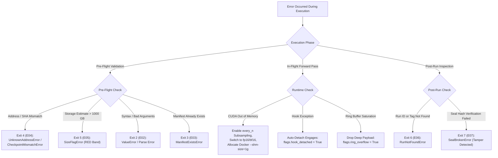

# Troubleshooting & FAQ Cookbook

**Comprehensive Diagnostics, Hardware Failure Modes, Error Triage, and Operational FAQ**

---

## Diagnostic Overview & Triage Decision Tree

When running high-density mechanistic flight recording and causal activation steering, failures can occur at various stages: weight scanning, declarative DSL validation, CUDA memory staging, or post-run cryptographic sealing. GlassBox is designed with fail-fast validation semantics and strict single-line error formatting (`Error EXX: <message>`) to simplify programmatic triage.

### Error Triage Decision Tree



```
┌────────────────────────────────────────────────────────────────────────────────────────┐
│                              FAST ERROR TRIAGE GUIDE                                   │
├──────────┬─────────────────────────────┬───────────────────────────────────────────────┤
│ Exit Code│ Programmatic Exception Class│ Recommended Remediation Action                │
├──────────┼─────────────────────────────┼───────────────────────────────────────────────┤
│ Exit 0   │ None (Success)              │ Run completed normally; hash chain sealed.    │
│ Exit 2   │ ValueError / FileNotFoundError│ Check CLI flags, YAML syntax, or token bounds.│
│ Exit 3   │ ManifestExistsError         │ Manifest exists for SHA; pass --force.        │
│ Exit 4   │ UnknownAddressError /       │ Re-run glassbox scan; update watchlist DSL to │
│          │ CheckpointMismatchError     │ valid model coordinates (e.g. N-01-0001).     │
│ Exit 5   │ SizeFlagError               │ RED footprint (>1000GB); add every_n or --force│
│ Exit 6   │ RunNotFoundError            │ Verify run ID in $GLASSBOX_DIR/runs/.         │
│ Exit 7   │ SealBrokenError             │ Tampering detected in deep.bin or index.      │
└──────────┴─────────────────────────────┴───────────────────────────────────────────────┘
```

---

## Master Exit Code Diagnostic Table

GlassBox defines exactly 8 CLI exit codes (0, 2..7 matching `E02`..`E07`) as defined in `glassbox/exceptions.py`.

| Exit Code | Error Tag | Programmatic Exception | Root Cause Description | Immediate Remediation |
| :---: | :---: | :--- | :--- | :--- |
| **`0`** | `OK` | None | Normal finalization and successful verification. | No action required. Run verified. |
| **`2`** | `E02` | `ValueError`<br/>`FileNotFoundError` | Bad argument usage, malformed YAML watchlist, unparseable query predicate, or missing input weights path. | Check syntax with `glassbox <cmd> --help`. Validate YAML indentation and query grammar quotes. |
| **`3`** | `E03` | `ManifestExistsError` | Attempting to `glassbox scan` a model checkpoint that already has an existing manifest directory for the same SHA-256. | Pass `--force` to overwrite the existing manifest: `glassbox scan /weights/path --force`. |
| **`4`** | `E04` | `UnknownAddressError`<br/>`CheckpointMismatchError` | Requested watchlist address does not exist in model inventory (e.g., `N-99-9999`), or watchlist checkpoint SHA-256 drifts from current model manifest. | Fails fast before GPU allocation. Inspect valid layer and neuron ranges in manifest. Re-scan if weights updated. |
| **`5`** | `E05` | `SizeFlagError` | Pre-flight capacity estimator forecasts a storage footprint exceeding $1,000\text{ GB}$ (RED capacity band). | Execution blocked to protect disk. Add token subsampling (`every_n: 10`), reduce window, or pass `--force`. |
| **`6`** | `E06` | `RunNotFoundError` | Specified `RUN-XXXXXX` directory does not exist, or comparison cohort tag expression matched zero runs. | Inspect runs directory via `glassbox size` or check tag filters with `glassbox find`. |
| **`7`** | `E07` | `SealBrokenError` | SHA-256 verification failure: computed hash differs from stored `seal.json`, or linear ledger link in `chain.jsonl` is broken. | File corrupted or tampered with. Inspect `chain.jsonl` audit trail. Restore from backup if necessary. |

---

### Exit 0: Success & Normal Finalization
Indicates that the command completed without error:
- During inference (`glassbox run`), activations were staged, written to disk, and the cryptographic seal was appended to `chain.jsonl`.
- During verification (`glassbox verify`), all SHA-256 digests and hash chain links matched perfectly.

---

### Exit 2 (E02): Bad Usage, Grammar Syntax, or Missing Files
Raised when arguments fail validation prior to execution:
```
Error E02: invalid query grammar near 'N-24-0042.max >' (missing operand)
```
- **Common Trigger 1:** Passing invalid CLI flags or omitting mandatory parameters.
- **Common Trigger 2:** Syntax errors in query strings passed to `glassbox find` or `glassbox compare`.
- **Common Trigger 3:** Specifying nonexistent YAML configuration files or missing model directories.

---

### Exit 3 (E03): Existing Manifest Conflict
Raised when executing `glassbox scan`:
```
Error E03: manifest exists for M-001 (sha256: 49666014...). Use --force to overwrite.
```
- **Cause:** GlassBox preserves reproducibility by refusing to overwrite scanned model inventories silently.
- **Solution:** If the model weights or architecture configs were intentionally updated, pass `--force`:
  ```bash
  glassbox scan /path/to/weights --force
  ```

---

### Exit 4 (E04): Unknown Address or Checkpoint SHA Drift
Raised during pre-flight validation before any GPU tensors are allocated:
```
Error E04: address N-48-0042 not found in manifest. Valid layers: 01..32.
Error E04: checkpoint mismatch: expected 49666014..., got 8b12f45c... Re-scan required.
```
- **Cause 1:** Requesting a layer index, attention head, or neuron coordinate outside the model's physical architecture.
- **Cause 2:** Using a watchlist calibrated against an older checkpoint version.
- **Invariant:** Nothing is executed, nothing is allocated on GPU, and no run is sealed.

---

### Exit 5 (E05): Red Storage Capacity Gate Triggered
Raised when the capacity estimator formula triggers the safety ceiling:
$$\text{Estimated Bytes} = W \times T \times R \times B \times 1.15 > 1,000\text{ GB}$$
```
Error E05: RED estimate (1,452.8 GB) exceeds 1000GB safety ceiling. Requires --force.
```
- **Cause:** Attempting to monitor tens of thousands of neurons across thousands of tokens across large batch runs.
- **Solution:** Subsample tokens via `every_n: 5`, narrow `window: {start_token: 0, end_token: 256}`, or pass `--force` if secondary NVMe storage is available.

---

### Exit 6 (E06): Run ID or Tag Cohort Not Found
Raised during offline queries, comparison, or verification:
```
Error E06: run 'RUN-000404' not found in store './glassbox_store/runs/'.
Error E06: compare group 'tag:cohort=exploit' matched 0 runs.
```
- **Cause:** Mistyped run identifier or empty cohort selection in `glassbox compare`.
- **Solution:** Verify available run directories using `glassbox size --by-run`.

---

### Exit 7 (E07): Cryptographic Seal Verification Failure
Raised when post-execution tampering or storage bit-rot occurs:
```
Error E07: seal mismatch for RUN-000003: computed 1e63e146..., expected f94b28a1...
```
- **Cause:** Even a single byte altered in `deep.bin`, `deep_index.json`, or `chain.jsonl` triggers cryptographic invalidation.
- **Visual Indication:** The Calm HTML Viewer displays a red tampering warning banner across the dashboard.

---

## GPU Memory and OOM Mitigations

Dense activation harvesting across 64 transformer layers can strain GPU VRAM. GlassBox provides four mitigation layers to prevent Out-Of-Memory (OOM) crashes:

### Watchlist Subsampling and Windowing
Instead of capturing every token for every neuron, configure window boundaries and sampling frequencies:
```yaml
version: 1
model_id: Qwen_Qwen3-14B
checkpoint_sha256: 0000000000000000000000000000000000000000000000000000000000000000
watchlist_id: subsampled_safety
trigger: always
window:
  start_token: 0
  end_token: 256
  every_n: 10
entries:
  - addresses: [N-24-0001..0256, A-18-01..04, L-24, LOGITS]
```
- `every_n: 10`: Decimates token capture rate by 90%, capturing activations every 10 tokens.
- `window`: Constrains telemetry capture to the critical prefill and opening thought tokens.

### Precision Selection and Sparse Compression
- **`precision: fp16` / `precision: bf16`:** Halves host and GPU staging buffer memory consumption compared to `fp32` (2 bytes per value vs 4 bytes).
- **Chunked Sparse Binary Storage (`compression: sparse`):** Compresses activation arrays using zlib blocks of 64 tokens, achieving 5x–10x disk savings while preserving sub-millisecond slice reads.

### Docker Shared Memory Sizing
When running GlassBox inside Docker containers, POSIX shared memory (`/dev/shm`) is capped at 64 MB by default. This causes immediate failure when mapping the triple ring buffer (`/dev/shm/gb.ring`):
```bash
# Correct Docker container launch command
docker run --gpus all --shm-size=1g -v /data:/data glassbox-research:latest
```
Allocate at least `--shm-size=1g` (or `--shm-size=2g` for multi-GPU setups).

---

## Hardware Backend Fallback Semantics

GlassBox abstracts hardware execution via `glassbox/gpu_adapters/`:

```
┌────────────────────────────────────────────────────────────────────────────────────────┐
│                          HARDWARE ADAPTER HIERARCHY                                    │
├─────────────────────┬──────────────────────────┬───────────────────────────────────────┤
│ Backend Adapter     │ Hardware Requirement     │ DMA & Staging Characteristics         │
├─────────────────────┼──────────────────────────┼───────────────────────────────────────┤
│ nvidia.py (Primary) │ NVIDIA GPU SM 8.0+       │ Non-blocking CUDA copyStream          │
│                     │ Driver 535+, CUDA 12+    │ Pinned host memory double-buffering   │
├─────────────────────┼──────────────────────────┼───────────────────────────────────────┤
│ cpu.py (Fallback)   │ Any x86_64 / ARM CPU     │ Queued clone() into bytearrays        │
│                     │ Universal CI & Laptop    │ Latency: ~0.005 ms per 1,000 values   │
├─────────────────────┼──────────────────────────┼───────────────────────────────────────┤
│ amd.py (Community)  │ AMD ROCm / HIP           │ Maps torch.cuda to HIP streams        │
│                     │ RDNA3 / CDNA GPUs        │ Environmental flag: ROCM_PATH         │
├─────────────────────┼──────────────────────────┼───────────────────────────────────────┤
│ apple.py (Community)│ Apple Silicon M1/M2/M3   │ MPS backend with synchronous blits    │
│                     │ macOS 14+                │ Documented as best-effort research    │
└─────────────────────┴──────────────────────────┴───────────────────────────────────────┘
```

### NVIDIA CUDA Execution Environment
- Fully non-blocking asynchronous DMA pipeline.
- Cross-stream event synchronization (`ready_event.record()` and `stream.wait_event()`) decouples compute warps from host transfers.

### Automatic CPU Fallback Semantics
- Activated automatically whenever `torch.cuda.is_available()` returns `False` or when explicitly set via environment variable:
  ```bash
  export GLASSBOX_GPU=cpu
  ```
- Uses memory-efficient bytearray queues without requiring pinned memory allocation.

### Apple Silicon MPS and AMD ROCm Caveats
- **Apple Silicon (`apple.py`):** PyTorch MPS currently lacks non-blocking cross-stream event barriers. Hook transfers use synchronized blits. Recommended for exploratory prototyping, not high-throughput profiling.
- **AMD ROCm (`amd.py`):** Requires ROCm 6.0+ and compatible HIP runtime. Set `HIP_VISIBLE_DEVICES=0`.

---

## Hook Detachment Safeguards

In safety research, hook errors or buffer saturation must never crash the primary host application:

### Automated Exception Unhooking
If any forward hook encounters a device runtime error (e.g., shape mismatch during dynamic speculative decoding):
1. DeepTap intercepts the exception in `glassbox/tap/hooks.py`.
2. Automatically calls `self.detach()`, removing all registered PyTorch hooks from the model.
3. Sets `flags["hook_detached"] = True` in run metadata.
4. Restores the model to its pristine native state, allowing inference to complete cleanly.

### Ring Buffer Overflow Protection
If the host disk sidecar process falls behind the GPU's generation throughput:
1. Producer detects all 3 ring slots are occupied (`write_seq - read_seq >= 3`).
2. DeepTap sets `flags["ring_overflow"] = True` and drops the newest activation payload.
3. The forward pass is **never stalled or blocked**. The model continues generating tokens at full speed.

---

## Cryptographic Verification Failure Diagnostics

GlassBox runs are sealed into an append-only linear hash ledger:
$$\text{hash}_i = \text{SHA256}\Big(\text{prev} \,\|\, \text{SHA256}(\text{deep\_index}) \,\|\, \text{SHA256}(\text{deep}) \,\|\, \text{canonical}(\text{replay})\Big)$$

### Detecting Single-Bit Flips in Binaries
To diagnose which component of a run failed verification:
```python
import glassbox

"""Programmatic verification"""
is_valid = glassbox.verify_run("RUN-000003")
if not is_valid:
    print("Verification failed: check seal.json against deep.bin and deep_index.json")
```
Run `glassbox verify RUN-000003 --json` to inspect step-by-step diagnostic outputs:
- `sha_index_match`: Indicates whether `deep_index.json` was altered.
- `sha_deep_match`: Indicates whether `deep.bin` suffered bit rot or byte truncation.
- `chain_continuity`: Indicates whether the preceding run link in `chain.jsonl` was modified.

### Repairing Broken Hash Chain Ledgers
If a multi-worker job terminates abruptly without finalizing `chain.jsonl`:
1. **Locate Last Durable Run:** Inspect `chain.jsonl` to find the last verified hash link.
2. **Re-Seal Prefix (`Sidecar.attach`):**
```python
from glassbox.tap.sidecar import Sidecar

sidecar = Sidecar(store="./glassbox_store", run_id="RUN-000003")
sealed_tokens = sidecar.seal_prefix()
print(f"Repaired run prefix with {sealed_tokens} durable tokens.")
```
3. Run `glassbox verify RUN-000003`. The system verifies the prefix and provides an `E1001` resume hint.

---

## Frequently Asked Questions

### Backward Compatibility and BlackBox Shims

#### Q: What is the relationship between GlassBox and BlackBox?
GlassBox is the current evolution of the original BlackBox project. For complete backward compatibility:
- `import blackbox` acts as a transparent alias for `import glassbox`.
- The CLI command `blackbox` forwards all commands, arguments, and exit codes directly to `glassbox`.
- Legacy magic headers (`BBRING01`, `BBSPR001`) are recognized and decoded identically to `GBRING01` and `GBSPR001`.

```python
"""Backward compatibility verification"""
import blackbox
import glassbox

assert blackbox.GlassBox is glassbox.GlassBox
assert blackbox.watch is glassbox.watch
```

---

### Performance Overhead Benchmarks

#### Q: How does GlassBox achieve <1% execution overhead?
Standard interpretability libraries execute synchronous `.cpu()` transfers inside forward hooks, introducing CUDA synchronization bubbles that degrade throughput by 15% to 40%. GlassBox achieves $<1\%$ overhead by:
1. Registering hooks only on parent modules (e.g. `model.layers.0.mlp`), never on individual neurons.
2. Performing column extraction on-device via `torch.index_select`.
3. Staging data onto a dedicated non-blocking CUDA `copyStream` with pinned host memory buffers (PBO).
4. Deferring host transfers until sequence prefill boundaries.

---

### Licensing and Citation

#### Q: Under what license is GlassBox distributed?
GlassBox is distributed under the **PolyForm Noncommercial License 1.0.0**. Academic researchers, students, and hobby experimenters may inspect, modify, and utilize the codebase freely for noncommercial research and education.

#### Q: How should GlassBox be cited in academic publications?
```bibtex
@software{glassbox2026,
  author = {Abdelhak Azzouz and the GlassBox Contributors},
  title = {GlassBox: Zero-Overhead Flight Recorder & Mechanistic Interpretability Engine for PyTorch LLMs},
  year = {2026},
  url = {https://github.com/azzouzabdelhak68-ship-it/glassbox}
}
```

---

## Related Documentation

- [User Guide](User-Guide.md) — Comprehensive installation and CLI reference
- [Architecture & Internals](Architecture-and-Internals.md) — Technical deep-dive into DMA staging and binary WAL
- [Research Playbook](Research-Playbook.md) — Mechanistic research methodologies and DLA attribution
- [Colab & Solo Testing Cookbook](Cookbook-Colab-and-Solo-Testing.md) — Cloud budget management and Google Drive streaming

---

<div align="center">
  <sub>GlassBox Troubleshooting & FAQ Cookbook • Verified Against glassbox/exceptions.py</sub>
</div>
