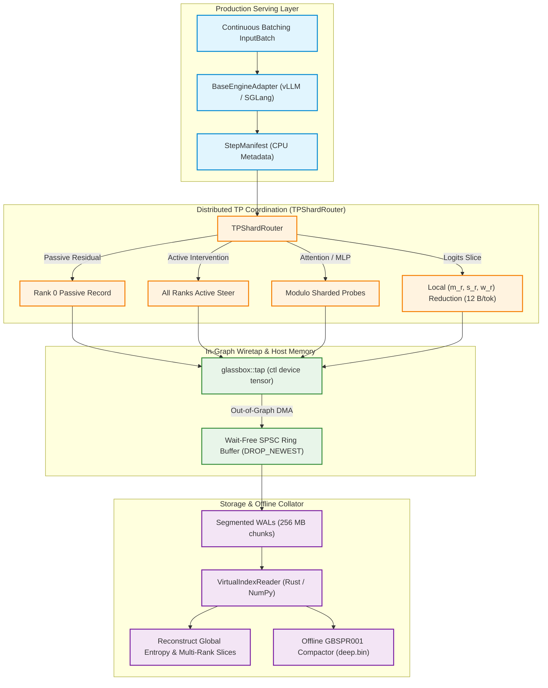

# Distributed Serving & Multi-GPU Architecture

GlassBox 2.0 expands the engine from a single-GPU PyTorch research instrument into a high-throughput, distributed mechanistic interpretability platform for production serving frameworks (vLLM V1 and SGLang SRT) across multi-GPU nodes with Tensor Parallelism (TP).

Recording activations or applying causal steering inside live production serving engines introduces three critical challenges:
1. **Continuous Batching Dynamic Geometries:** Production engines pack disjoint requests of varying sequence lengths into unified 1D flat token vectors with dynamic prefix caching (e.g. RadixAttention / PagedAttention).
2. **CUDA Graph Capture Invariants:** Modern serving engines replay static CUDA Graphs during the decode phase. Standard PyTorch hooks that allocate memory, dynamically branch, or synchronize streams crash CUDA Graph replay.
3. **Inter-GPU Network Overhead:** Sharding attention heads, MLP neurons, and vocabularies across multiple GPUs normally requires expensive NVLink `all_reduce` or `all_gather` operations for every tapped probe, destroying serving latency.

GlassBox 2.0 solves all three challenges with a zero-NVLink distributed architecture, a two-stage CUDA Graph-safe wiretap, and a Rust-accelerated segmented WAL collator.

---

## Visual Architecture Overview

### 1. Distributed Multi-GPU Architecture Scheme

```
=======================================================================================================================
                                      GLASSBOX 2.0 DISTRIBUTED ARCHITECTURE
=======================================================================================================================

     [ Client Request Traffic ] ── (Continuous Batching: vLLM V1 / SGLang SRT)
                  │
                  ▼
   ┌─────────────────────────────── Distributed Tensor Parallel (TP=N) ───────────────────────────────┐
   │                                                                                                  │
   │   ┌───────────────────────────────┐                  ┌───────────────────────────────┐           │
   │   │         GPU Rank 0            │                  │         GPU Rank r (r > 0)    │           │
   │   ├───────────────────────────────┤                  ├───────────────────────────────┤           │
   │   │  Residual Stream (L-*, NORM)  │                  │  Residual Stream (L-*, NORM)  │           │
   │   │  • Passive: RECORD ON RANK 0  │                  │  • Passive: SKIPPED (0 B/tok) │           │
   │   │  • Active:  STEER ALL RANKS   │                  │  • Active:  STEER ALL RANKS   │           │
   │   ├───────────────────────────────┤                  ├───────────────────────────────┤           │
   │   │  Attention Heads (A-LL-HH)    │                  │  Attention Heads (A-LL-HH)    │           │
   │   │  • Local Heads (0..H/N-1)     │                  │  • Local Heads (rH/N..(r+1)H) │           │
   │   ├───────────────────────────────┤                  ├───────────────────────────────┤           │
   │   │  MLP Neurons (N-LL-NNNN)      │                  │  MLP Neurons (N-LL-NNNN)      │           │
   │   │  • Local Neurons (0..D/N-1)   │                  │  • Local Neurons (rD/N..(r+1))│           │
   │   ├───────────────────────────────┤                  ├───────────────────────────────┤           │
   │   │  Logits Entropy Reduction     │                  │  Logits Entropy Reduction     │           │
   │   │  • Compute (m_0, s_0, w_0)    │                  │  • Compute (m_r, s_r, w_r)    │           │
   │   │  • 12 B/tok (0 NVLink traffic)│                  │  • 12 B/tok (0 NVLink traffic)│           │
   │   └──────────────┬────────────────┘                  └──────────────┬────────────────┘           │
   │                  │                                                  │                            │
   │                  ▼                                                  ▼                            │
   │   ┌───────────────────────────────┐                  ┌───────────────────────────────┐           │
   │   │  CUDA Graph-Safe Tap Op       │                  │  CUDA Graph-Safe Tap Op       │           │
   │   │  • glassbox::tap(act,ctl,slab)│                  │  • glassbox::tap(act,ctl,slab)│           │
   │   │  • Post-Replay D2H DMA Copy   │                  │  • Post-Replay D2H DMA Copy   │           │
   │   └──────────────┬────────────────┘                  └──────────────┬────────────────┘           │
   └──────────────────┼──────────────────────────────────────────────────┼────────────────────────────┘
                      │                                                  │
                      ▼                                                  ▼
     ┌─────────────────────────────────┐                ┌─────────────────────────────────┐
     │ Wait-Free SPSC Host Ring Buffer │                │ Wait-Free SPSC Host Ring Buffer │
     │ • DROP_NEWEST Fail-Open Policy  │                │ • DROP_NEWEST Fail-Open Policy  │
     └────────────────┬────────────────┘                └────────────────┬────────────────┘
                      │                                                  │
                      ▼                                                  ▼
     ┌─────────────────────────────────┐                ┌─────────────────────────────────┐
     │ Rank 0 Segmented WALs           │                │ Rank r Segmented WALs           │
     │ • runs/<ID>/ranks/rank_0/       │                │ • runs/<ID>/ranks/rank_r/       │
     │ • 256MB chunks, posix_fadvise   │                │ • 256MB chunks, posix_fadvise   │
     └────────────────┬────────────────┘                └────────────────┬────────────────┘
                      │                                                  │
                      └───────────────────────┬──────────────────────────┘
                                              │
                                              ▼
                             ┌─────────────────────────────────┐
                             │ Tri-Language Virtual Index      │
                             │ (crates/glassbox_collator/)     │
                             │ • Virtual Index Join (Step, Req)│
                             │ • Zero Physical File Merging    │
                             │ • Exact Global Shannon Entropy  │
                             │ • Offline GBSPR001 Compactor    │
                             └─────────────────────────────────┘
=======================================================================================================================
```

### 2. Distributed Execution Flowchart



---

## Engine Backend Abstraction Layer

The engine backend layer decouples serving engines from telemetry collection through the [`BaseEngineAdapter`](User-Guide.md) protocol:

```python
from abc import ABC, abstractmethod
from typing import Any, ClassVar

class BaseEngineAdapter(ABC):
    """Uniform contract isolating serving engine hooks from GlassBox core."""

    backend_name: ClassVar[str]

    def __init__(self, tp_rank: int = 0, tp_size: int = 1, **kwargs: Any) -> None:
        self.tp_rank = tp_rank
        self.tp_size = tp_size

    @classmethod
    @abstractmethod
    def validate_engine(cls, engine: Any) -> bool:
        """Return True if engine instance matches this adapter."""

    @abstractmethod
    def attach(self, engine: Any, watchlist: dict[str, Any], **kwargs: Any) -> Any:
        """Inject hooks or worker extensions into the serving engine."""

    @abstractmethod
    def detach(self) -> None:
        """Cleanly remove all interceptors and restore baseline state."""

    @abstractmethod
    def flush(self) -> None:
        """Flush in-flight buffers to disk."""
```

### 1. vLLM V1 Worker Extension (`glassbox.backends.vllm`)
GlassBox hooks into vLLM V1 via `GlassBoxWorkerExtension`. In continuous batching, requests enter and finish generation at arbitrary tokens. `GlassBoxWorkerExtension` intercepts `execute_model` on each worker subprocess:
- Extracts token layouts from `execute_model_req` and `InputBatch`.
- Generates a lightweight CPU-side `StepManifest` recording `step_id`, `req_ids`, `query_start_loc`, and `logical_positions`.
- Binds per-request activation buffers into static slabs.

### 2. SGLang SRT RadixAttention (`glassbox.backends.sglang`)
SGLang organizes continuous batching via RadixAttention cache trees. `SGLangEngineAdapter` extracts:
- `extend_start_loc` and `extend_seq_lens` for prefill token rows.
- `req_pool_indices` mapping physical cache slots back to unique logical request IDs.

### 3. PyTorch Single-GPU Baseline (`glassbox.backends.pytorch`)
Wraps the classic single-GPU `DeepTap` and `SteeringController` pipeline, preserving 100% backward compatibility for standard research workflows without continuous batching.

---

## Distributed Tensor Parallel Sharding

Under Tensor Parallelism (TP), model parameters and forward activations are partitioned across $N$ GPUs. Naive probe harvesting would either duplicate redundant representations or require inter-GPU synchronization.

The `TPShardRouter` (`glassbox.tap.distributed`) establishes mathematically sound routing invariants:

```python
from glassbox.tap.distributed import TPShardRouter

router = TPShardRouter(
    tp_rank=0,
    tp_size=4,
    architecture={"num_attention_heads": 32, "intermediate_size": 14336},
)
```

### 1. Asymmetric Residual Stream Invariant
In Tensor Parallel architectures (Megatron-LM style), row-parallel layers perform an `all_reduce` summation before outputting the residual stream. Consequently:
- **Residual representations (`L-*`, `NORM`, `EMBED`) are identical across all ranks.**
- **Passive Recording:** Recorded exclusively by **Rank 0**. Ranks $1 \dots N-1$ skip recording, saving $N-1 \times$ host RAM and disk bandwidth.
- **Active Steering:** Interventions on the residual stream must be applied **identically across ALL ranks** (`should_steer(address) == True` on all ranks). Applying steering to only one rank would violate mathematical consistency and cause forward divergence.

### 2. Attention Head & MLP Neuron Sharding
- **Attention Heads (`A-LL-HH`):** Head indices ($1 \le HH \le H$) are modulo-partitioned across ranks:
  $$\text{owner\_rank} = \left\lfloor \frac{HH - 1}{H / \text{tp\_size}} \right\rfloor, \quad \text{local\_idx} = (HH - 1) \bmod \left(\frac{H}{\text{tp\_size}}\right)$$
- **MLP Neurons (`N-LL-NNNN`):** Column-parallel intermediate neurons are partitioned similarly based on intermediate dimension $D_{\text{mlp}}$.

---

## Zero-NVLink Logits Shannon Entropy Reduction

In distributed serving, vocabulary logits are partitioned across ranks (e.g. `ParallelLMHead`). Computing exact Shannon entropy $H = -\sum_{i=1}^V p_i \ln p_i$ normally requires an all-gather of the full vocabulary across NVLink.

GlassBox replaces all-gather communication with a local **3-scalar reduction** (12 bytes per token per rank):

### 1. Mathematical Local Reduction
On each rank $r$ owning vocabulary subset $V_r$, compute:
$$\begin{aligned}
m_r &= \max_{j \in V_r} x_j \\
s_r &= \sum_{j \in V_r} e^{x_j - m_r} \\
w_r &= \sum_{j \in V_r} (x_j - m_r) \, e^{x_j - m_r}
\end{aligned}$$

Each scalar is a standard float32 (4 bytes). Total communication payload: **12 bytes per token**.

### 2. Exact Global Reconstruction Formula
Given $(m_r, s_r, w_r)$ from all ranks $r \in \{0, \dots, N-1\}$, the collator reconstructs global Shannon entropy offline without any generation-time synchronization:
$$\begin{aligned}
M &= \max_{r} m_r \\
S &= \sum_{r} s_r \cdot e^{m_r - M} \\
W &= \sum_{r} \left( w_r + (m_r - M) \cdot s_r \right) \cdot e^{m_r - M} \\
H &= \ln(S) - \frac{W}{S} \quad \text{(in nats)}
\end{aligned}$$

This formulation is numerically stable (leveraging max-shift $M$) and mathematically identical to the full-vocabulary softmax Shannon entropy.

```python
import numpy as np
from glassbox.tap.distributed import TPShardRouter

# Rank 0 local vocab slice logits
rank0_logits = np.array([2.0, 1.5, 0.1], dtype=np.float32)
# Rank 1 local vocab slice logits
rank1_logits = np.array([3.1, -0.5, 1.2], dtype=np.float32)

r0_scalars = TPShardRouter.compute_local_logits_reduction(rank0_logits)
r1_scalars = TPShardRouter.compute_local_logits_reduction(rank1_logits)

global_entropy = TPShardRouter.reconstruct_global_entropy([r0_scalars, r1_scalars])
# Yields exact global Shannon entropy in nats
```

---

## Two-Stage CUDA Graph-Safe Wiretap

CUDA Graph capture prohibits dynamic memory allocation, shape mutations, or host synchronization during graph replay. GlassBox implements a two-stage wiretap:

### 1. In-Graph Stage: `glassbox::tap` Custom Op
- Operates on a pre-allocated static HBM staging slab.
- Governed by a 3-element device control tensor `ctl` (int32 / int64):
  - `ctl[0]`: Kill-switch ($0 = \text{disabled}, 1 = \text{active}$).
  - `ctl[1]`: `actual_num_tokens` to gather (rows $0 \dots \text{actual\_num\_tokens}-1$).
  - `ctl[2]`: Active staging slot index ($0 \dots K-1$).
- Gathers specified feature columns directly into the static staging slab within the captured graph without dynamic allocations.

### 2. Out-of-Graph Stage: Stream Copy & Synchronization
- Immediately after graph replay completes, an asynchronous D2H copy executes on a dedicated CUDA `copyStream`.
- Synchronized via `cudaEventRecord` on the compute stream and `cudaStreamWaitEvent` on the copy stream, leaving CPU host execution completely unblocked.

### 3. Hardware & Pure-Python Fallbacks
For non-CUDA platforms (Apple Silicon, CPU, testing environments), `glassbox.csrc_fallback` provides registered pure-Python NumPy and Triton `@torch.library.custom_op` implementations, ensuring seamless testing without native compilation.

---

## Wait-Free SPSC Host Ring Buffer & Rust Collator

Telemetry collected from distributed GPUs is ingested by an asynchronous host-side storage architecture:

### 1. Wait-Free SPSC Ring Buffer (`csrc/ring_buffer.h`)
- Single-Producer Single-Consumer (SPSC) lockless circular ring buffer located in pinned host memory.
- **Fail-Open `DROP_NEWEST` Policy:** If host disk I/O stalls, the buffer drops the newest incoming token slice, increments an atomic dropped counter, and emits an explicit `{step_id, status: DROPPED}` tombstone record. Inference forward passes are never stalled by telemetry backpressure.

### 2. Segmented WAL Format (`crates/glassbox_collator/`)
- Each rank writes to local size-rotated binary WAL files (`runs/<ID>/ranks/rank_<r>/segment_<seq>.bin`).
- Size-rotated at 256 MB boundaries with 4 MB block alignment.
- Evicts completed chunks from OS page cache using `posix_fadvise(DONTNEED)` (on Linux) to prevent telemetry from starving host memory.

### 3. Virtual Multi-Rank Indexing (`VirtualIndexReader`)
Rather than physically merging gigabytes of multi-rank files at run completion, the collator builds a lightweight dynamic in-memory index:
- Slices from different ranks are indexed by `(global_step_id, req_id)`.
- Querying an address automatically routes to the correct rank's WAL segment and extracts the slice with zero physical file duplication.

### 4. Offline Compactor (`GBSPR001`)
When long-term archival or fast visualization is required, an offline background compactor consolidates multi-rank segmented WALs into standard compressed `deep.bin` and `deep_index.json` files fully compatible with [`Architecture & Internals`](Architecture-and-Internals.md) and [`User Guide`](User-Guide.md) viewing tools.

---

## Production Serving Integration Recipe

Here is how to instrument a production serving engine with GlassBox 2.0:

```python
from glassbox import GlassBox

# Initialize GlassBox with auto-detection for distributed serving
with GlassBox.watch(
    watchlist={
        "entries": [
            {"addresses": ["L-18", "A-18-01", "LOGITS-ENTROPY"]},
        ]
    },
    backend="auto",
    tp_size=4,
    tp_rank=0,
) as recorder:
    # Serving engine execution (e.g. vLLM or SGLang worker loop)
    pass

# Query multi-rank virtual index after run completion
reader = GlassBox.open_reader("runs/RUN-0001")
slice_data = reader.query_slice(
    global_step_id=42,
    req_id="req-user-101",
    address="A-18-01",
)
```

---

<div align="center">
  <sub>Part of the GlassBox Distributed Interpretability Suite • PolyForm Noncommercial</sub>
</div>
