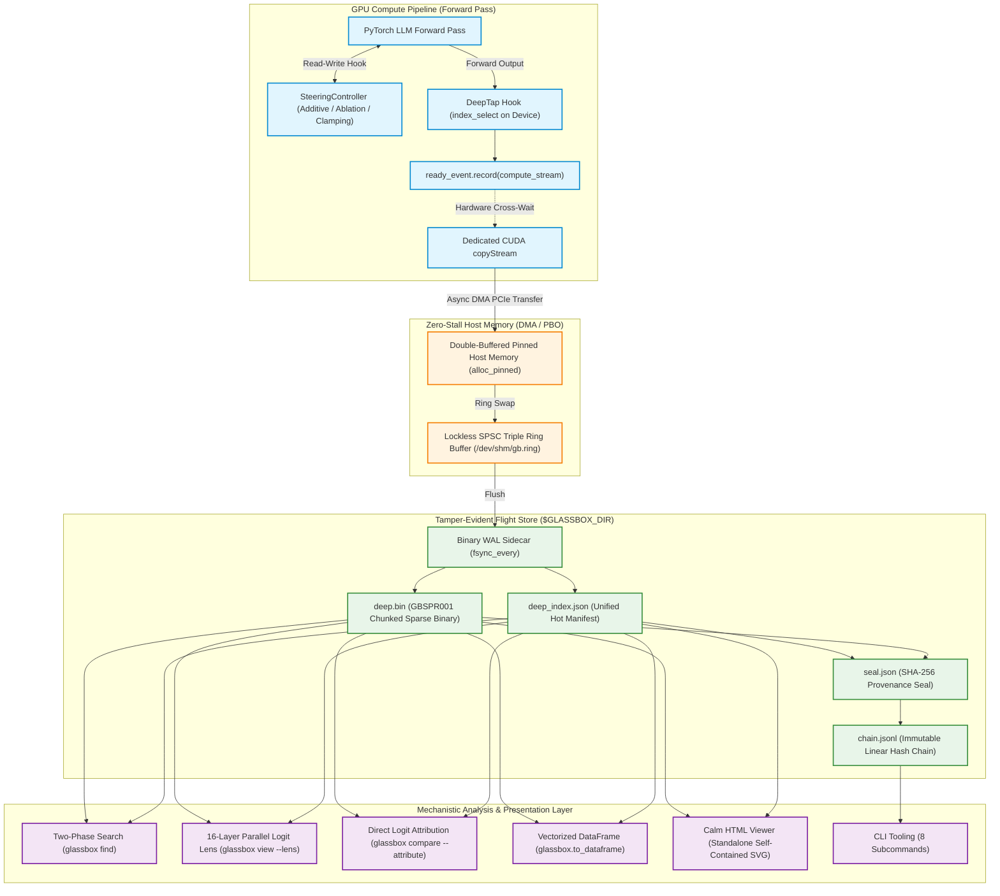

# GlassBox: Flight Recorder & Mechanistic Interpretability Engine

> **Tamper-Evident Activation Telemetry, Real-Time Causal Steering, and Cryptographic Run Provenance for PyTorch Large Language Models**

---

## Welcome to the GlassBox Wiki

**GlassBox** is an open-source flight recorder and mechanistic interpretability instrumentation engine for PyTorch large language models. While traditional LLM observability platforms monitor models from the outside—logging external prompts, completions, latency, and token consumption—GlassBox operates **inside the model weights**. It captures intermediate activations, attention head projections, residual stream progressions, and output logits during generation with **<1% compute overhead**, completely eliminating the CUDA synchronization stalls that plague naive PyTorch hooks.

Whether you are an **academic researcher** proving the existence of safety circuits with cryptographic guarantees or a **solo experimenter** reverse-engineering prompt reasoning on a single consumer GPU or in Google Colab, GlassBox gives you the tools to see inside the black box.

---

## Visual Summary: Capability & Hardware Matrix

### 1. Architectural Comparison

| Capability / Metric | Traditional Observability (LangSmith, W&B, OTel) | Naive PyTorch Forward Hooks | GlassBox Flight Recorder Engine |
| :--- | :--- | :--- | :--- |
| **Observation Domain** | External text strings, API latency, tokens | Internal activations via `.cpu()` / `.item()` | Full internal tensor representations |
| **GPU Compute Impact** | Zero (does not monitor internal forward pass) | **15% – 40% throughput collapse** (CUDA bubbles) | **<1% overhead**: Asynchronous CUDA DMA copyStream |
| **Fidelity & Precision** | Text tokens only; internal states discarded | CPU numpy arrays; high memory pressure | Native `fp32`, `fp16`, and IEEE `bf16` round-to-nearest-even |
| **Storage Architecture** | Centralized databases (Postgres, ClickHouse) | Uncompressed pickle / raw disk files | Chunked sparse binary (`GBSPR001` zlib), <1ms slice reads |
| **Tamper-Evidence** | Mutable rows; no cryptographic seal | None; ad-hoc logging | **SHA-256 sealed run provenance** + append-only ledger |
| **Causal Control** | None (passive observation only) | Manual monkey-patching of forward passes | **Real-time steering & orthogonal subspace ablation** |
| **Interpretability Tools** | None (black box treatment) | External scripts required | **Logit Lens**, **DLA Attribution**, **SAE feature latents** |
| **Reporting & UI** | Heavy SaaS dashboards (React, NodeJS, CDN) | Ad-hoc matplotlib / Jupyter plots | **Calm HTML Viewer**: Zero-NPM, self-contained SVG |

### 2. Supported Hardware & Platform Tiers

| Platform / Backend | Hardware Target | Implementation Mechanism | Status |
| :--- | :--- | :--- | :--- |
| **NVIDIA CUDA** (`nvidia.py`) | Ampere (SM 8.0+), Ada Lovelace, Hopper (A100, H100, RTX 3090/4090) | Non-blocking DMA over dedicated `copyStream`, double-buffered pinned host RAM (PBO) | **Primary (Production)** |
| **Universal CPU** (`cpu.py`) | Linux, macOS, Windows (x86_64, ARM64) | Memory-efficient queued `clone()` into pre-allocated bytearrays (~0.005 ms/1k) | **Fully Supported (CI & Dev)** |
| **Apple Metal** (`apple.py`) | Apple Silicon M-series (M1/M2/M3/M4 Max/Ultra) | Synchronized unified memory blits with host-shared unified address space | **Community Supported** |
| **AMD ROCm** (`amd.py`) | AMD Instinct & Radeon (MI250, MI300X, RX 7900 XTX) | HIP stream and event translation mapping to asynchronous pinned DMA | **Community Supported** |

---

## Dual Value Proposition

GlassBox is purposefully engineered to bridge the gap between rigorous scientific interpretability research and accessible everyday exploration.

```
       ┌─────────────────────────────────────────────────────────────────────────────────┐
       │                                GLASSBOX ENGINE                                  │
       │                   Mechanistic Flight Recorder & Control Plane                   │
       └────────────────────────┬────────────────────────────────┬───────────────────────┘
                                │                                │
                Academic & Frontier Research          Solo Hobbyists & Independent Testers
       ┌────────────────────────────────────────┐       ┌────────────────────────────────────────┐
       │ • Cryptographic SHA-256 Provenance     │       │ • Zero Cloud Lock-In & Zero Setup      │
       │ • Linear Hash Ledger (chain.jsonl)     │       │ • Colab Free & Pro Ready (<20 min)     │
       │ • Zero CUDA Bubbles (<1% Overhead)     │       │ • 7 Deterministic Watchlist Presets    │
       │ • Exact IEEE bfloat16 Bit Fidelity     │       │ • Calm Viewer (Zero-NPM Self-Contained)│
       │ • Direct Logit Attribution (DLA)       │       │ • Pre-Flight Capacity Safety Gates     │
       │ • Real-Time Causal Subspace Ablation   │       │ • Single Consumer GPU / CPU Fallbacks  │
       └────────────────────────────────────────┘       └────────────────────────────────────────┘
```

### For Academic & Frontier Safety Researchers
1. **Provable Reproducibility & Cryptographic Integrity:** Every execution run is cryptographically sealed upon context exit using the normative formula:
   $$\text{hash}_i = \text{SHA256}\Big(\text{prev} \,\|\, \text{SHA256}(\text{deep\_index}) \,\|\, \text{SHA256}(\text{deep}) \,\|\, \text{canonical}(\text{replay})\Big)$$
   All runs are chained into an append-only linear audit ledger (`chain.jsonl`). Any post-hoc file modification, bit corruption, or metadata tampering immediately invalidates verification with exit code 7 (`E07: SealBrokenError`).
2. **Zero CUDA Compute Bubbles (<1% Overhead):** Academic forward-pass hooks typically call `.cpu()` or `.item()` synchronously, creating CPU-GPU synchronization barriers that stall streaming multiprocessors (SMs) and distort wall-clock latency profiles. GlassBox schedules memory transfers across dedicated CUDA copyStreams, keeping GPU compute fully saturated.
3. **True Bit-Level Representation Fidelity:** Activations can be stored in full `fp32`, `fp16`, or true IEEE `bf16` using hardware-accurate round-to-nearest-even encoding. Slices can be queried in $<1\text{ ms}$ directly via memory-mapped sparse storage (`deep.bin`).
4. **Principled Mechanistic Tooling:** Includes a 16-layer parallel Logit Lens (`glassbox.lens`), Direct Logit Attribution ranking between cohorts ($A = \Delta \mu \cdot (\Delta \text{FR} + 1.0)$), and causal activation intervention (`SteeringController`) with mathematically exact norm preservation.
5. **Empirical Frontier Validation:** Validated on frontier models including `Qwen/Qwen3.8-27B` (discovering pre-thought refusal locks at `<|im_end|>`, latent Chinese safety circuits, and Layer-18 Gated DeltaNet sentinels).

### For Solo Hobbyists, Independent Testers & Evaluators
1. **Zero Specialized Infrastructure Required:** Runs out-of-the-box on consumer desktop GPUs (RTX 3060/3080/4090), Apple Silicon MacBooks (M-series), or plain CPU.
2. **Turnkey Google Colab Execution:** Complete 1-click execution in Google Colab notebooks (`notebooks/quickstart_demo.ipynb` on free T4/CPU in 60s; `notebooks/a100_stretch_test.ipynb` under 20-minute Colab Pro budgets with a 16.5-minute safety watchdog).
3. **7 Deterministic YAML Presets:** Never spend hours figuring out which layer or tensor to monitor. Use battle-tested presets like `pilot-sparse-1k`, `logit-lens`, `attention_only`, `last-4-layers-full`, `ioi-circuit-starter`, or `outer_only` with a single command.
4. **Calm HTML Viewer (Zero NPM, Zero CDN):** Export interactive visual dashboards (`report.html`) featuring inline SVG activation heatmaps, z-score matrices, and circuit co-occurrence graphs. It requires zero Node.js, zero React, and zero external network calls.
5. **Safety Capacity Gates (GREEN / YELLOW / RED):** An integrated pre-flight capacity estimator calculates exact storage requirements ($\text{Bytes} = W \times T \times R \times B \times 1.15$) before touching the GPU, preventing disk overflows with hard limits (runs $>1,000\text{ GB}$ require explicit `--force`).

---

## Visual Architecture Overview

GlassBox decouples the GPU compute pipeline from telemetry persistence using a non-blocking asynchronous pipeline and dual-mode intervention controllers.

### 1. Unicode / ASCII Architecture Scheme

```
=======================================================================================================================
                                           GLASSBOX RUNTIME ARCHITECTURE
=======================================================================================================================

  [ PyTorch LLM Forward Pass ] ── (Inference Execution on Default CUDA Stream 0)
               │
               ├──► [ SteeringController ] ── (Real-Time Additive Vector Steering / Subspace Ablation / Clamping)
               │
               ▼
  [ DeepTap PyTorch Hook Engine ]
         │
         ├──► On-Device Column Selection (index_select in GPU VRAM)
         ├──► CUDA Event Record (ready_event placed in compute stream)
         │
         ▼
  [ Dedicated CUDA copyStream ] ── (Non-Blocking Hardware DMA Pipeline)
         │
         ├──► Stream Cross-Wait: copy_stream.wait_event(ready_event) [GPU-Only Hardware Wait]
         ├──► Pinned Host Transfer: pinned_buffer.copy_(gathered, non_blocking=True)
         │
         ▼
  [ Pinned Host Double-Buffer (PBO) ]
         │
         ▼
  [ Lockless SPSC Ring Buffer ] ── (/dev/shm/gb.ring, GBRING01, 33-byte header, Producer/Consumer Cache-Disjoint)
         │
         ├──► [ Binary WAL Sidecar ] ── (wal/<RUN-ID>.wal.bin, struct.pack("<i", token_pos) + raw_bytes, fsync)
         │
         ▼
  [ Storage Engine: $GLASSBOX_DIR/runs/RUN-XXXXXX/ ]
         ├──► deep.bin             ── Chunked Sparse Compressed Binary Matrix (GBSPR001, zlib, 64-tok chunks)
         ├──► deep_index.json      ── Unified Hot Manifest (metadata, prompt, tokens, timing, replay)
         ├──► seal.json            ── Cryptographic SHA-256 Run Seal (sha_index, sha_deep, prev_hash, hash)
         └──► chain.jsonl          ── Linear Append-Only Provenance Ledger (filelock protected)
         │
         ▼
  [ Analysis, Intervention & Presentation Engine ]
         ├──► Two-Phase Search     ── Tier-1 Hot Index Candidate Filter + Tier-2 Cold Slice Verification
         ├──► Logit Lens           ── 16-Layer Parallel Unembedding Projection & Entropy Tracking
         ├──► DLA Engine           ── Direct Logit Attribution Cohort Comparison (PRO-GOOD vs PRO-BAD)
         ├──► DataFrame Exporter   ── Zero-Copy Memory-Mapped Slices to Pandas / Polars (to_dataframe)
         ├──► Calm HTML Viewer     ── Standalone Single-File Dashboard with Interactive Inline SVG Matrices
         └──► CLI Suite (8 Tools)  ── scan, run, find, compare, verify, view, size, export

=======================================================================================================================
```

### 2. Mermaid Architecture Flowchart



---

## Complete Table of Contents

Explore the comprehensive GlassBox documentation suite:

```
wiki/
├── Home.md                                  ◄ You are here
├── _Sidebar.md                              ◄ Persistent GitHub Wiki navigation
├── User-Guide.md                            ◄ Installation, hardware tiers, DSL syntax & CLI manual
├── Research-Playbook.md                     ◄ Mechanistic methodology, DLA, safety battery & profiling
├── Discovery-and-Hypothesis-Catalog.md      ◄ Empirical Qwen3.8-27B discoveries & research catalog
├── Activation-Steering-and-Ablation-Guide.md◄ Causal steering, norm preservation & subspace ablation
├── Architecture-and-Internals.md            ◄ Non-blocking DMA, GBSPR001, SHA-256 sealing & Logit Lens
├── Cookbook-Colab-and-Solo-Testing.md       ◄ Google Colab 20-min budget, Drive streaming & fallbacks
└── Cookbook-Troubleshooting-and-FAQ.md      ◄ Error codes E02-E07, OOM mitigations & verification FAQ
```

### 1. [User Guide](User-Guide.md)
*Complete operational manual for installing, configuring, and running GlassBox.*
- **System Installation:** Python $\ge 3.10$, PyTorch $\ge 2.4$, CUDA 12.1–13.2 (SM 8.0+), and CPU/MPS fallbacks.
- **Hardware Architecture Setup:** NVIDIA `nvidia.py`, Apple Silicon `apple.py`, AMD ROCm `amd.py`, and CPU `cpu.py`.
- **Declarative Watchlist DSL:** Coordinate syntax (`N-LL-NNNN`, `A-LL-HH`, `L-LL`, `LOGITS`, `LOGITS-ENTROPY`, `SAE-LL-FFFF`).
- **The 7 Built-In Deterministic Presets:** `pilot-sparse-1k`, `logit-lens`, `attention_only`, `last-4-layers-full`, `mid-mlp-wide`, `ioi-circuit-starter`, and `outer_only`.
- **Complete 8-Command CLI Reference:** In-depth documentation for `scan`, `run`, `find`, `compare`, `verify`, `view`, `size`, and `export`.
- **Standardized Error Exit Codes:** Reference table for codes `0`, `2` (`E02`), `3` (`E03`), `4` (`E04`), `5` (`E05`), `6` (`E06`), and `7` (`E07`).

### 2. [Research Playbook](Research-Playbook.md)
*Scientific methodology and protocols for mechanistic interpretability research.*
- **The 5-Step Mechanistic Research Loop:** Formulate $\rightarrow$ Probe $\rightarrow$ Harvest $\rightarrow$ Attribute $\rightarrow$ Intervene.
- **Hypothesis Formulation Templates:** Standardized schemas for specifying target phenotypes, circuit coordinates, operational metrics, and intervention predictions.
- **Direct Logit Attribution (DLA):** Mathematical foundation ($A = \Delta \mu \cdot (\Delta \text{FR} + 1.0)$) and CLI discovery workflows.
- **The 4-Module Safety & Alignment Battery:** Contrastive pairs for Refusal triggers, Sycophancy tests, Truthfulness & Myth-traps, and Framing resilience.
- **Automated Watchlist Calibration Profiler:** Discover top-$k$ high-variance features over sample domain texts (`glassbox.profile`).
- **Vectorized DataFrame Analysis:** Zero-copy memory-mapped querying directly into Pandas and Polars (`glassbox.to_dataframe`).

### 3. [Discovery & Hypothesis Catalog](Discovery-and-Hypothesis-Catalog.md)
*Empirical discoveries from frontier models and a catalog of open research hypotheses.*
- **Featured Frontier Discovery on Qwen3.8-27B:**
  - *Pre-Thought Refusal Lock:* Refusal commitment occurs 7 tokens before `<think>` begins at the `<|im_end|>` token ($+9.71 / +11.51$ vs $+0.50$ baseline, $H = 0.04..0.12$ nats).
  - *Dual-Use Deliberation Wave:* Second internal self-censorship wave at token 249 suppressing dual-use scanner code ($+2.21 \rightarrow +4.81$).
  - *Latent Chinese Safety Circuit:* Layers 39–56 activate Chinese safety concepts, driving 26% probability mass to `'中文'` at Layer 56 on `' final'`, causally forcing `"Need final in English."`.
  - *Layer-18 Gated DeltaNet Sentinels:* Early recurrent tripwire attention heads (`A-18-01..03`) surging by $+64\%$ L2 norm on harmful triggers at only 28% model depth.
  - *16-Layer Entropy Double Crossover:* Transition from unconstrained recurrent DeltaNet cognition ($H \approx 11$ nats) to an immediate $-5.4$ nat collapse in global full attention.
- **Catalog of Open Hypotheses:** Ready-to-test experimental specifications for sycophancy suppression, hallucination dampening, and roleplay jailbreak resilience.

### 4. [Activation Steering & Ablation Guide](Activation-Steering-and-Ablation-Guide.md)
*In-depth guide to real-time causal intervention in PyTorch models.*
- **Dual-Mode Execution Architecture:** Using `SteeringController` directly or integrating via `GlassBox.watch(..., steer=[...], ablate=[...])`.
- **Additive Vector Steering:** Injecting directional concepts ($\mathbf{x} \leftarrow \mathbf{x} + \alpha \mathbf{v}$) into residual streams, MLPs, or attention blocks.
- **Norm Preservation Mathematics:** Eliminating perplexity explosion by re-normalizing steered vectors back to baseline L2 magnitude:
  $$\mathbf{x}_{\text{steered}} = (\mathbf{x} + \alpha \mathbf{v}) \cdot \frac{\|\mathbf{x}\|_2}{\|\mathbf{x} + \alpha \mathbf{v}\|_2 + \epsilon}$$
- **Directional Orthogonal Subspace Ablation:** Mathematically projecting out unwanted behavioral directions:
  $$\mathbf{x} \leftarrow \mathbf{x} - \frac{\mathbf{x} \cdot \mathbf{d}}{\|\mathbf{d}\|_2^2 + \epsilon} \mathbf{d}$$
- **Neuron Clamping & Attention Head Silencing:** Surgical zeroing, clamping to bounds ($[\text{min}, \text{max}]$), or mean-clamping of individual neurons (`N-LL-NNNN`) and heads (`A-LL-HH`).
- **Token Conditioning:** Target autoregressive decoding (`mode="decode"`), prompt prefill (`mode="prefill"`), or exact token index ranges.

### 5. [Architecture & Internals](Architecture-and-Internals.md)
*Deep engineering internals of the zero-overhead engine and binary flight store.*
- **Non-Blocking Asynchronous DMA Pipeline:** Dedicated CUDA `copyStream`, cross-stream event barriers (`ready_event`), double-buffered pinned host memory (PBO), and parent-module-only hook registration.
- **Lockless SPSC Triple-Buffer Ring Buffer:** Memory-mapped `/dev/shm/gb.ring` (`GBRING01`), 33-byte header layout, cache-disjoint producer/consumer boundaries, and binary durability WAL (`.wal.bin`).
- **Fault-Tolerance Guarantees:** Ring overflow protection (drops newest Deep payload, never stalls inference), automated hook detachment on exception, and crash recovery with prefix sealing.
- **Chunked Sparse Binary Storage (`deep.bin`):** `GBSPR001` format, 24-byte header, 16-byte chunk table, zlib compression, and $<1\text{ ms}$ random-access slice reads (`read_deep_slice`).
- **Cryptographic Run Provenance:** 5-step tamper-evident verification algorithm, canonical JSON replay serialization, and inter-process file locking on `chain.jsonl`.
- **16-Layer Parallel Logit Lens Engine:** Residual stream unembedding projection, layer delta updates, and Shannon entropy metrics across depth.

### 6. [Colab & Solo Testing Cookbook](Cookbook-Colab-and-Solo-Testing.md)
*Hands-on guide for independent experimenters and testing in Google Colab.*
- **Solo Tester Workflows:** Running full mechanistic evaluations on consumer hardware or free Google Colab (T4 / CPU).
- **Google Colab 20-Minute Budget Management:** Complete runtime strategy with an automated 16.5-minute safety watchdog to avoid GPU disconnects.
- **Two-Tier Google Drive Streaming Bridge:** Incremental telemetry flushing every 50 tokens with `os.fsync`, logging a 1 GB milestone, and enforcing a 2 GB hard abort ceiling.
- **DeltaNet Fast Kernel Guards & Auto-Fallbacks:** Intercepting missing C++ wheels (`fla` / `causal_conv1d`) to prevent slow CPU loop hangs by falling back to native BF16 `Qwen/Qwen3-14B`.
- **Low-Cost Experiment Recipes:** Step-by-step instructions for running Indirect Object Identification (IOI) circuits and small-scale factual recall probes.

### 7. [Troubleshooting & FAQ Cookbook](Cookbook-Troubleshooting-and-FAQ.md)
*Comprehensive diagnostics, error resolution, and frequently asked questions.*
- **Master Error Code Diagnostic Table:** Root causes, reproduction steps, and immediate fixes for errors `E02`, `E03`, `E04`, `E05`, `E06`, and `E07`.
- **GPU Memory & OOM Mitigations:** Watchlist subsampling, precision tuning (`fp16`/`bf16`), chunked sparse compression, and Docker shared memory configuration (`--shm-size=1g`).
- **Hardware Backend Fallback Semantics:** CUDA fallback to CPU, Apple Silicon MPS caveats, and ROCm environment variables.
- **Cryptographic Verification Failure Diagnostics:** Detecting bit flips, metadata edits, and repairing broken hash chains.
- **General FAQ:** Common questions about backward compatibility (`blackbox` shims), licensing, and performance benchmarking.

---

## Quickstart Guide

### Python API Quickstart

#### 1. Scan Model Weights (CPU, 2–10 seconds, once per checkpoint)
Inspect safetensors metadata and architecture config without loading model weights into GPU VRAM:
```bash
glassbox scan /path/to/llama-3-8b
```

#### 2. Declarative Recording with `GlassBox.watch`
Record internal activations during generation with sub-1% overhead using a declarative watchlist:

```python
from glassbox import GlassBox
import torch
from transformers import AutoModelForCausalLM, AutoTokenizer

model_id = "meta-llama/Meta-Llama-3-8B"
tokenizer = AutoTokenizer.from_pretrained(model_id)
model = AutoModelForCausalLM.from_pretrained(model_id, torch_dtype=torch.float16, device_map="cuda")

prompt = "The capital of France is"
inputs = tokenizer(prompt, return_tensors="pt").to("cuda")

with GlassBox.watch("watchlists/pilot.yaml", manifest="manifests/M-001/manifest.json") as ctx:
    output_ids = model.generate(**inputs, max_new_tokens=20)

print(f"Recorded and cryptographically sealed as run: {ctx.run_id}")
```

#### 3. Real-Time Causal Activation Steering
Intervene causally during inference with norm preservation:

```python
from glassbox import SteeringController, steer, ablate

u_refusal = torch.load("refusal_vector_L64.pt")  # Pre-computed refusal direction

controller = SteeringController(model)
controller.add_steering(layer=64, vector=u_refusal, scale=-1.5, norm_preserve=True)
controller.add_ablation("A-18-03", mode="zero")

with controller:
    steered_output = model.generate(**inputs, max_new_tokens=64)
```

#### 4. Cryptographic Seal Verification
Independently verify that run activations and metadata have not been tampered with:

```python
import glassbox

is_valid = glassbox.verify_run("RUN-000001")  # Validates deep.bin, deep_index.json & chain.jsonl
print(f"Cryptographic seal valid: {is_valid}")
```

#### 5. Mechanistic Analysis & DataFrame Export
Analyze intermediate layers using the Logit Lens or query directly as a memory-mapped DataFrame:

```python
import glassbox

lens_results = glassbox.lens("RUN-000001", token_pos=17)
print("Peak computational update at layer:", lens_results["max_delta_layer"])

df = glassbox.to_dataframe("RUN-000001", tokens=(0, 64), what="full")
print(df.head())
```

---

### Command-Line (CLI) Quickstart

GlassBox ships with exactly 8 focused subcommands:

```bash
glassbox scan /path/to/model-weights
glassbox run --watch watchlists/pilot.yaml --tag cohort=eval --seed 42
glassbox find "tag:cohort=eval AND N-24-0042.max > 2.0" --table
glassbox compare --good tag:cohort=truthful --bad tag:cohort=hallucinated --neurons N-24-0001..0100,A-17-04 --attribute
glassbox verify RUN-000001
glassbox view RUN-000001 --lens
glassbox view RUN-000001 --export-html ./report.html
glassbox size
```

---

## Getting Started: Recommended Reading Paths

- **If you are new to GlassBox:** Begin with the **[User Guide](User-Guide.md)** for step-by-step installation, hardware configuration, and your first flight recording.
- **If you are conducting mechanistic research:** Read the **[Research Playbook](Research-Playbook.md)** and the **[Activation Steering & Ablation Guide](Activation-Steering-and-Ablation-Guide.md)** to structure your experimental hypotheses and causal interventions.
- **If you want empirical case studies:** Dive into the **[Discovery & Hypothesis Catalog](Discovery-and-Hypothesis-Catalog.md)** to inspect the Qwen3.8-27B safety circuit findings.
- **If you are testing on Colab or consumer GPUs:** Jump straight into the **[Colab & Solo Testing Cookbook](Cookbook-Colab-and-Solo-Testing.md)**.
- **If you encounter an issue or error code:** Consult the **[Troubleshooting & FAQ Cookbook](Cookbook-Troubleshooting-and-FAQ.md)**.

---

<div align="center">
  <b>GlassBox: Making LLM Internals Clear as Glass</b><br>
  <sub>Licensed under PolyForm Noncommercial 1.0.0 • Maintained by the GlassBox Contributors</sub>
</div>
