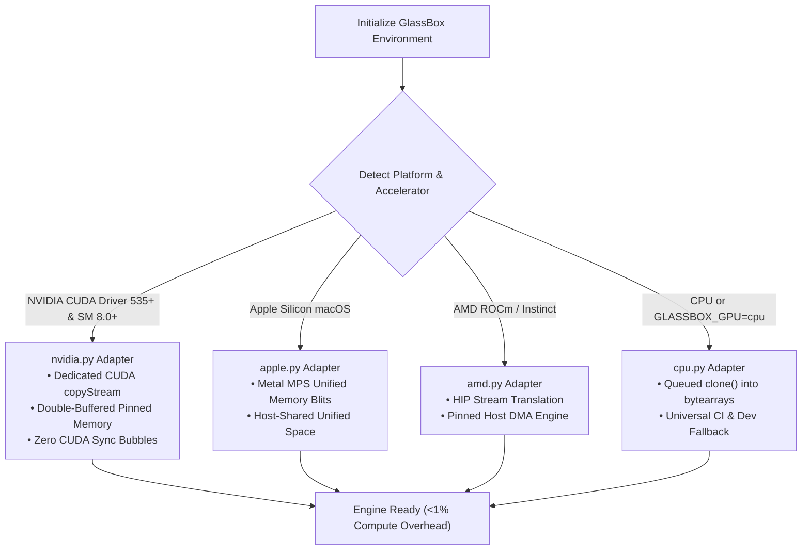
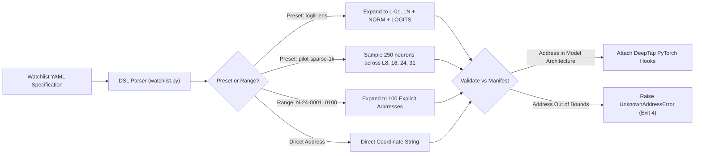
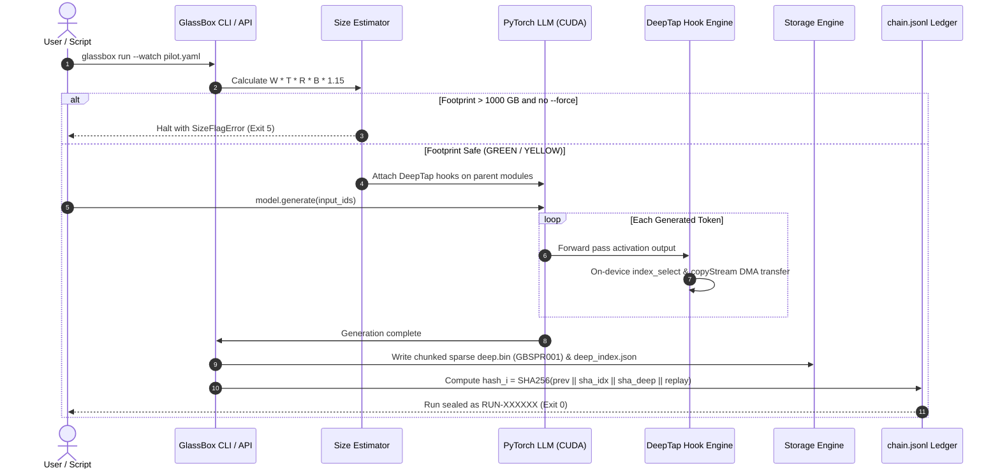

# GlassBox User Guide: Installation, Workflows & CLI Manual

> **Comprehensive End-to-End Operational Manual for PyTorch LLM Telemetry, Watchlist Probing, and Cryptographic Run Sealing**

---

## Table of Contents

- [Overview & Getting Started](#overview-getting-started)
- [Installation and Hardware Tiers](#installation-and-hardware-tiers)
  - [System Requirements](#system-requirements)
  - [Package Installation](#package-installation)
  - [Hardware Architecture Adapters](#hardware-architecture-adapters)
  - [Verification & Health Checks](#verification-health-checks)
- [Watchlist Addressing DSL and Presets](#watchlist-addressing-dsl-and-presets)
  - [Declarative Probing Architecture](#declarative-probing-architecture)
  - [Coordinate Addressing DSL Syntax](#coordinate-addressing-dsl-syntax)
  - [The 7 Built-In Deterministic Presets](#the-7-built-in-deterministic-presets)
  - [Watchlist File Structure](#watchlist-file-structure)
- [Flight Recording Workflow](#flight-recording-workflow)
  - [Step 1: Checkpoint Scanning (`glassbox scan`)](#step-1-checkpoint-scanning-glassbox-scan)
  - [Step 2: Watchlist Authoring](#step-2-watchlist-authoring)
  - [Step 3: Pre-Flight Capacity Estimator & Safety Bands](#step-3-pre-flight-capacity-estimator--safety-bands)
  - [Step 4: Flight Recording Execution](#step-4-flight-recording-execution)
  - [Step 5: Cryptographic Verification](#step-5-cryptographic-verification)
  - [Step 6: Interactive Inspection & Dashboards](#step-6-interactive-inspection-dashboards)
- [CLI Reference Manual](#cli-reference-manual)
  - [Command Suite Matrix](#command-suite-matrix)
  - [Detailed Command Specifications](#detailed-command-specifications)
  - [Standardized Exit Codes](#standardized-exit-codes)
- [Visual Schemes and Flowcharts](#visual-schemes-and-flowcharts)
  - [Installation & Hardware Selection Pipeline](#installation-hardware-selection-pipeline)
  - [Watchlist Coordinate Resolution Pipeline](#watchlist-coordinate-resolution-pipeline)
  - [End-to-End Flight Recording Lifecycle](#end-to-end-flight-recording-lifecycle)

---

## Overview & Getting Started

**GlassBox** is an open-source flight recorder and mechanistic interpretability instrumentation engine for PyTorch large language models. Unlike external application monitors that only capture text prompts and completion strings, GlassBox captures intermediate activations, attention head projections, residual stream progressions, and output logits from **inside the model weights** with **<1% compute overhead**.

This guide covers:
1. Setting up GlassBox across NVIDIA GPUs, Apple Silicon, AMD ROCm, and universal CPU environments.
2. Formulating declarative watchlists using coordinate addressing syntax.
3. Running flight recordings with automated storage capacity gates and cryptographic provenance sealing.
4. Mastering the complete 8-command CLI tool suite and interpreting typed error codes.

For mechanistic research protocols and causal intervention guides, see the [Research Playbook](Research-Playbook.md). For high-level project information and architectural summaries, return to the [Wiki Home](Home.md).

---

## Installation and Hardware Tiers

GlassBox is designed to run seamlessly from single consumer laptops up to enterprise multi-GPU clusters.

### System Requirements

| Component | Minimum Specification | Recommended Specification |
| :--- | :--- | :--- |
| **Python** | `>= 3.10` (compatible with 3.10, 3.11, 3.12, 3.13) | `3.11` or `3.12` |
| **PyTorch** | `>= 2.4.0` | Latest stable `torch` with CUDA 12.4+ |
| **Operating System** | Linux (Ubuntu 20.04+, Debian 11+, RHEL 9+), macOS 13+, Windows 10/11 | Linux x86_64 or aarch64 |
| **Hardware** | x86_64 or ARM64 CPU with 8 GB RAM | NVIDIA Ampere/Ada/Hopper GPU (SM 8.0+) with 16 GB+ VRAM |
| **Shared Memory** | Default host `/dev/shm` | `--shm-size=1g` or larger when running inside Docker containers |

### Package Installation

GlassBox can be installed from PyPI or cloned from source for active development.

#### Installing via PyPI

```bash
pip install glassbox
```

#### Installing from Source (Editable Mode)

For development or benchmark reproducibility, clone the repository and install all optional dependency groups:

```bash
git clone https://github.com/azzouzabdelhak68-ship-it/glassbox.git
cd glassbox/
pip install -e ".[dev,search]"
```

Optional dependency groups include:
- `dev`: Developer tooling including `ruff>=0.4`, `mypy>=1.10`, and `pytest>=8.0`.
- `search`: High-performance analytical columnar search engines (`pyarrow>=15`, `duckdb>=1.0`).

#### Backward Compatibility Alias

GlassBox maintains 100% backward compatibility with its earlier project name, `blackbox`. Both `import blackbox` in Python and the `blackbox` CLI executable forward transparently to `glassbox` without deprecation warnings.

### Hardware Architecture Adapters

GlassBox employs a pluggable adapter architecture (`glassbox/gpu_adapters/`) to provide specialized zero-overhead telemetry across heterogeneous hardware.

```
┌─────────────────────────────────────────────────────────────────────────────────────────┐
│                                GLASSBOX HARDWARE ADAPTERS                               │
├──────────────────────────┬──────────────────────────┬───────────────────────────────────┤
│ Backend Module           │ Target Hardware          │ Mechanism                         │
├──────────────────────────┼──────────────────────────┼───────────────────────────────────┤
│ nvidia.py                │ NVIDIA SM 8.0+           │ Dedicated CUDA copyStream + PBO   │
│ cpu.py                   │ Linux, macOS, Windows    │ Queued clone() into bytearrays    │
│ apple.py                 │ Apple Silicon M-series   │ Synchronized unified memory blits │
│ amd.py                   │ AMD Instinct & Radeon    │ HIP stream translation to pinned  │
└──────────────────────────┴──────────────────────────┴───────────────────────────────────┘
```

#### 1. NVIDIA CUDA Architecture (`glassbox/gpu_adapters/nvidia.py`)
- **Target Support:** NVIDIA Ampere (A100, RTX 3080/3090), Ada Lovelace (RTX 4080/4090, L40S), and Hopper (H100, H200) architectures with Compute Capability (SM) 8.0+.
- **Zero-Stall DMA Engine:** Schedules device-to-host tensor memory copies across a dedicated `torch.cuda.Stream()` (the `copyStream`), completely independent of the default PyTorch compute stream (`stream 0`).
- **Double-Buffered Pinned Host Memory (PBO):** Memory pages are locked in physical RAM using `alloc_pinned()`, enabling the GPU's asynchronous DMA copy engines to stream tensors across the PCIe bus without virtual memory paging delays.
- **On-Device Column Selection:** Gathers watched MLP neurons and attention head projections directly inside GPU VRAM via `torch.index_select()`, preventing full-layer tensor transfers over PCIe.
- **Cross-Stream Hardware Wait:** Places a lightweight `torch.cuda.Event` into the compute stream. The `copyStream` awaits this marker on-device (`stream.wait_event(ready_event)`), allowing the host CPU forward pass to continue unblocked.

#### 2. Universal CPU Architecture (`glassbox/gpu_adapters/cpu.py`)
- **Target Support:** Any standard Linux, macOS, or Windows x86_64 or ARM64 workstation.
- **Implementation:** Employs memory-efficient queued `clone()` into pre-allocated contiguous bytearrays, achieving sub-microsecond latency (`~0.005 ms` per 1,000 features).
- **Activation:** Selected automatically when CUDA is not present, or forced explicitly by setting the environment variable `GLASSBOX_GPU=cpu`.

#### 3. Apple Silicon Metal Performance Shaders (`glassbox/gpu_adapters/apple.py`)
- **Target Support:** Apple Silicon M1, M2, M3, and M4 chips (Pro, Max, Ultra).
- **Implementation:** Uses PyTorch MPS backend primitives to coordinate synchronized unified memory blits within Apple's unified memory architecture.

#### 4. AMD ROCm Architecture (`glassbox/gpu_adapters/amd.py`)
- **Target Support:** AMD Instinct (MI210, MI250, MI300X) and Radeon RX 7000 series.
- **Implementation:** Maps PyTorch CUDA primitives to AMD HIP streams and events, delivering asynchronous DMA transfers into host memory on ROCm-supported Linux kernels.

### Verification & Health Checks

Run the verification test suite to ensure your environment is fully operational:

```bash
GLASSBOX_GPU=cpu pytest -q

mypy glassbox/

ruff check .
```

---

## Watchlist Addressing DSL and Presets

### Declarative Probing Architecture

Standard mechanistic interpretability scripts often rely on ad-hoc PyTorch hook callbacks scattered across notebook cells. GlassBox replaces this with declarative, version-controlled YAML files called **Watchlists**.

A Watchlist defines precisely which internal weights, residual layers, attention heads, or output logits to monitor, what token window to capture, what numerical precision to store, and what triggers should activate recording.

```
       ┌──────────────────────────────────────────────────────────────┐
       │                   WATCHLIST SPECIFICATION                    │
       │  Addresses: [N-24-0001..0100, A-18-01..04, L-16, LOGITS]     │
       └──────────────────────────────┬───────────────────────────────┘
                                      │
            ┌─────────────────────────┼─────────────────────────┐
            ▼                         ▼                         ▼
   ┌─────────────────┐       ┌─────────────────┐       ┌─────────────────┐
   │   MLP Neurons   │       │ Attention Heads │       │ Residual Stream │
   │   N-24-0001     │       │   A-18-01       │       │   L-16          │
   │   N-24-0002     │       │   A-18-02       │       │   L-16-0512     │
   │   ...           │       │   ...           │       │   ...           │
   │   N-24-0100     │       │   A-18-04       │       │   LOGITS        │
   └─────────────────┘       └─────────────────┘       └─────────────────┘
```

### Coordinate Addressing DSL Syntax

GlassBox implements a compact, human-readable coordinate syntax to target any internal transformer tensor:

| Address Pattern | Target Description | Coordinate Format | Example |
| :--- | :--- | :--- | :--- |
| `N-LL-NNNN` | MLP intermediate expansion neuron | Layer `LL` (2 digits), neuron `NNNN` (4 digits, 1-indexed) | `N-24-0042` |
| `A-LL-HH` | Attention head activation L2 norm | Layer `LL` (2 digits), head `HH` (2 digits, 1-indexed) | `A-18-03` |
| `L-LL` | Residual stream layer L2 norm | Layer `LL` (2 digits) across all hidden dimensions | `L-16` |
| `L-LL-DDDD` | Specific residual hidden dimension | Layer `LL` (2 digits), hidden dimension `DDDD` (4 digits) | `L-16-0512` |
| `SAE-LL-FFFF` | Sparse Autoencoder monosemantic feature | Layer `LL` (2 digits), latent feature `FFFF` (4 digits) | `SAE-24-0412` |
| `F-LL-FFFF` | Feature alias for Sparse Autoencoders | Layer `LL` (2 digits), latent feature `FFFF` (4 digits) | `F-12-0089` |
| `LOGITS` | Top-1 predicted logit value | Output unembedding projection maximum logit | `LOGITS` |
| `LOGITS:<id>` | Target vocabulary token logit | Output unembedding logit for specific token ID `<id>` | `LOGITS:3000` |
| `LOGITS-ENTROPY` | Output vocabulary Shannon entropy | Shannon entropy $H(p) = -\sum p_i \log p_i$ across vocabulary | `LOGITS-ENTROPY` |
| `EMBED` | Embedding layer output norm | L2 norm of initial token embedding representation | `EMBED` |
| `NORM` | Final pre-head normalization norm | L2 norm of activations after final LayerNorm / RMSNorm | `NORM` |
| `X..Y` | Inclusive numerical range expansion | Expands contiguous neuron, head, or coordinate ranges | `N-24-0001..0100` |

#### Range Expansion Rules
- `N-24-0001..0100` expands to 100 distinct addresses (`N-24-0001`, `N-24-0002`, ..., `N-24-0100`).
- `A-18-01..08` expands to 8 distinct attention heads (`A-18-01`, ..., `A-18-08`).
- `L-16..20` expands to 5 residual stream layer norms (`L-16`, `L-17`, `L-18`, `L-19`, `L-20`).

### The 7 Built-In Deterministic Presets

To accelerate research and avoid guesswork, GlassBox provides 7 deterministic presets defined in `glassbox/watchlist.py`. Presets adapt automatically to the layer count, head count, and MLP dimension of the target model manifest:

| # | Preset Name | Watched Coordinates | Probe Volume ($W$) | Primary Use Case |
|---|:---|:---|:---|:---|
| 1 | `pilot-sparse-1k` | 250 seeded neurons across layers 8, 16, 24, and 31 (`random.Random(42)`) | Exactly 1,000 neurons | Rapid exploratory baseline; low-overhead broad health checks |
| 2 | `logit-lens` | All residual streams $L_1 \dots L_N$ plus `NORM` and `LOGITS` | $\text{layers} + 2$ probes | Tracking representation emergence and entropy collapse across layers |
| 3 | `attention_only` | All attention heads across all transformer layers | $\text{layers} \times \text{heads}$ probes | Circuit discovery; isolating induction, translation, or refusal heads |
| 4 | `last-4-layers-full` | All attention heads, MLP neurons, and logits across final 4 layers | Varies by model (e.g. ~58,000) | Investigating final output commitment, calibration, and refusal gates |
| 5 | `mid-mlp-wide` | Layers 12 through 20 all MLP neurons with `every_n: 10` subsampling | Varies by model (e.g. ~120,000) | Broad mid-network concept formation; knowledge retrieval circuits |
| 6 | `ioi-circuit-starter` | Canonical Indirect Object Identification heads (`A-17..24` heads 4, 7, 12) + neurons (`N-20..24` 1..200) | Exactly 1,024 probes | Testing synthetic reasoning circuits and duplicate token tracking |
| 7 | `outer_only` | Captures prompt tokens, completion tokens, seed, and timing | Exactly 0 internal tensors ($W=0$) | Control baseline; black-box benchmark latency validation |

### Watchlist File Structure

A standard YAML watchlist contains metadata, checkpoint binding, execution window gating, and target entries:

```yaml
version: 1
model_id: meta-llama_Meta-Llama-3-8B
checkpoint_sha256: 496660148f94d9b4b1a473f27f058097d8b5c986927d2c38e9c9a0c7eb108d44
watchlist_id: pilot_safety_v1
trigger: always
window:
  start_token: 0
  end_token: 512
  every_n: 1
precision: fp16
entries:
  - addresses:
      - N-24-0001..0100
      - A-18-01..04
      - L-16
      - L-24
      - LOGITS
      - LOGITS-ENTROPY
```

#### Key Fields:
- `checkpoint_sha256`: Cryptographically binds this watchlist to a specific weight manifest. If checkpoint drift is detected, GlassBox halts with `CheckpointMismatchError (exit 4)`.
- `trigger`: Execution gate (`always`, `on_token`, or conditional expression).
- `window`: Constrains telemetry recording to token positions between `start_token` and `end_token`. The `every_n` parameter downsamples token steps for long-context generation runs.
- `precision`: Data encoding precision: `fp32` (4 bytes), `fp16` (2 bytes), or true IEEE `bf16` (2 bytes with round-to-nearest-even).

---

## Flight Recording Workflow

The GlassBox flight recording workflow consists of six deterministic steps:

```
┌──────────────────┐     ┌──────────────────┐     ┌──────────────────┐
│  1. Model Scan   │ ──► │  2. Watchlist    │ ──► │  3. Size Safety  │
│  glassbox scan   │     │  YAML Definition │     │  Capacity Check  │
└──────────────────┘     └──────────────────┘     └──────────────────┘
                                                           │
┌──────────────────┐     ┌──────────────────┐              │
│  6. View & Export│ ◄── │  5. Cryptographic│ ◄────────────┘
│  Calm HTML / CLI │     │  SHA-256 Verify  │     4. Monitored Run
└──────────────────┘     └──────────────────┘     glassbox.watch()
```

### Step 1: Checkpoint Scanning (`glassbox scan`)

Before monitoring a model for the first time, scan its weights on CPU. The scan inspects `config.json` and tensor headers in `model.safetensors` to establish structural architecture dimensions and compute the authoritative checkpoint SHA-256 digest:

```bash
glassbox scan /path/to/checkpoint
```

This creates a permanent manifest at `manifests/<MODEL_ID>_<SHA8>/manifest.json`. Scanning runs entirely on CPU in 2 to 10 seconds without allocating GPU memory.

### Step 2: Watchlist Authoring

Select a built-in preset or create a custom YAML watchlist specifying your addresses of interest. For example, save the following as `watchlists/my_experiment.yaml`:

```yaml
version: 1
model_id: meta-llama_Meta-Llama-3-8B
checkpoint_sha256: 0000000000000000000000000000000000000000000000000000000000000000
watchlist_id: my_experiment
trigger: always
window:
  start_token: 0
  end_token: 256
  every_n: 1
precision: fp16
entries:
  - preset: logit-lens
  - addresses:
      - N-16-0001..0050
```

### Step 3: Pre-Flight Capacity Estimator & Safety Bands

To prevent accidental disk exhaustion during high-density multi-run evaluations, GlassBox calculates the exact storage footprint before GPU memory allocation:

$$\text{Estimated Bytes} = W \times T \times R \times B \times 1.15$$

Where:
- $W$: Total watched addresses count.
- $T$: Effective token count per run (adjusted for `every_n`).
- $R$: Number of runs in the batch (default 1).
- $B$: Byte width per feature (`fp32`: 4, `fp16`: 2, `bf16`: 2).
- $1.15$: Standard 15% safety factor accounting for `deep_index.json`, search shards, and cryptographic seals.

#### Safety Bands:
- **GREEN (< 50 GB):** Safe execution. The run begins immediately.
- **YELLOW (50 GB – 1,000 GB):** Elevated storage. GlassBox prints a warning banner and proceeds.
- **RED (> 1,000 GB):** Dangerously large run. GlassBox aborts immediately, raising `SizeFlagError (exit 5)`. To override this safety gate, users must pass the explicit `--force` flag.

Check estimated store capacity at any time via the CLI:

```bash
glassbox size
glassbox size --by-run
```

### Step 4: Flight Recording Execution

#### Method A: Python API (`glassbox.watch`)

Wrap any standard PyTorch or Hugging Face generation loop with `GlassBox.watch()`:

```python
import torch
from transformers import AutoModelForCausalLM, AutoTokenizer
import glassbox  # flight recorder engine

GlassBox = glassbox.GlassBox

model_id = "meta-llama/Meta-Llama-3-8B"
tokenizer = AutoTokenizer.from_pretrained(model_id)
model = AutoModelForCausalLM.from_pretrained(
    model_id,
    torch_dtype=torch.float16,
    device_map="cuda",
)

prompt = "The key to mechanistic interpretability is"
inputs = tokenizer(prompt, return_tensors="pt").to("cuda")

with GlassBox.watch("watchlists/my_experiment.yaml", tag={"cohort": "eval", "seed": "42"}) as ctx:
    output_ids = model.generate(**inputs, max_new_tokens=64)

print(f"Inference recorded and cryptographically sealed as: {ctx.run_id}")
```

#### Method B: Command-Line Interface (`glassbox run`)

Execute monitored inference directly from your shell:

```bash
glassbox run --watch watchlists/my_experiment.yaml --tag cohort=eval --seed 42 --limit 64
```

### Step 5: Cryptographic Verification

Upon exiting the `watch()` context or completing `glassbox run`, GlassBox seals all run artifacts using the normative SHA-256 chaining formula:

$$\text{hash}_i = \text{SHA256}\Big(\text{prev} \,\|\, \text{SHA256}(\text{deep\_index}) \,\|\, \text{SHA256}(\text{deep}) \,\|\, \text{canonical}(\text{replay})\Big)$$

Verify the cryptographic integrity of any historical run:

```bash
glassbox verify RUN-000001

glassbox verify --all
```

If any byte of `deep.bin` or `deep_index.json` has been altered or corrupted post-run, verification fails immediately with exit code 7 (`E07: SealBrokenError`).

### Step 6: Interactive Inspection & Dashboards

Inspect recorded runs in your terminal or generate interactive browser dashboards:

```bash
glassbox view RUN-000001 --lens

glassbox view RUN-000001 --tokens 10..20 --addrs N-16-0001..0010

glassbox view RUN-000001 --export-html ./report.html
```

---

## CLI Reference Manual

GlassBox exposes exactly 8 subcommands via `glassbox/cli.py`. Each command is strictly scoped, returns standardized output, and maps to deterministic exit codes.

### Command Suite Matrix

| Command | Signature | Primary Flags | Purpose |
| :--- | :--- | :--- | :--- |
| **`scan`** | `glassbox scan [weights_path]` | `--output`, `--force`, `--json` | Scans CPU safetensors/config headers into `manifest.json`. |
| **`run`** | `glassbox run --watch <file>` | `--tag`, `--seed`, `--limit`, `--trigger`, `--precision`, `--force`, `--dry-run`, `--json` | Executes inference with a watchlist and cryptographically seals output. |
| **`find`** | `glassbox find [query]` | `--limit`, `--json`, `--table`, `--verify`, `--tokens` | Executes two-phase search (Tier-1 Hot index filter + Tier-2 Cold slice verify). |
| **`compare`**| `glassbox compare --good <q> --bad <q> --neurons <addrs>` | `--stat`, `--tokens`, `--limit`, `--attribute`, `--json` | Statistical cohort comparison and Direct Logit Attribution (DLA) ranking. |
| **`verify`** | `glassbox verify [run_ids ...]` | `--all`, `--json`, `--chain` | Validates SHA-256 run seal integrity and linear hash chain continuity. |
| **`view`** | `glassbox view [run_id]` | `--open`, `--port`, `--export-html`, `--lens`, `--tokens`, `--addrs`, `--no-color`, `--json` | Displays terminal tables, Logit Lens analysis, or exports Calm HTML reports. |
| **`size`** | `glassbox size` | `--by-model`, `--by-run`, `--json`, `--dir` | Reports storage usage and evaluates GREEN/YELLOW/RED safety capacity gates. |
| **`export`** | `glassbox export --zip --run <id>` | `--out`, `--with-manifest`, `--with-index` | Bundles run artifacts into a self-contained portable zip archive. |

### Detailed Command Specifications

#### 1. `glassbox scan`
Scans local model weights on CPU into a standardized GlassBox manifest.

```bash
glassbox scan /data/models/Llama-3-8B

glassbox scan /data/models/Llama-3-8B --output manifests/custom_manifest.json --json

glassbox scan /data/models/Llama-3-8B --force
```

#### 2. `glassbox run`
Executes monitored inference with an active watchlist and seals run evidence.

```bash
glassbox run --watch watchlists/pilot.yaml

glassbox run --watch watchlists/pilot.yaml --tag cohort=eval --tag split=test --seed 42 --limit 128 --precision fp16

glassbox run --watch watchlists/pilot.yaml --dry-run
```

#### 3. `glassbox find`
Executes high-throughput two-phase search across all historical runs.

```bash
glassbox find "tag:cohort=eval AND N-24-0042.max > 2.0" --table

glassbox find "tag:cohort=eval" --limit 10 --json

glassbox find "tag:cohort=eval" --verify --tokens 0..64
```

#### 4. `glassbox compare`
Performs cohort contrastive analysis and computes Direct Logit Attribution (DLA) scores.

```bash
glassbox compare --good tag:cohort=truthful --bad tag:cohort=hallucinated --neurons N-24-0001..0100

glassbox compare --good tag:cohort=truthful --bad tag:cohort=hallucinated --neurons N-24-0001..0100,A-18-01..04 --attribute

glassbox compare --good tag:cohort=refusal --bad tag:cohort=benign --neurons A-18-01..04 --stat mean,p95,firing_rate --tokens 15..30
```

#### 5. `glassbox verify`
Validates cryptographic seals against the linear hash chain (`chain.jsonl`).

```bash
glassbox verify RUN-000001

glassbox verify RUN-000001 RUN-000002 RUN-000003

glassbox verify --all --json
```

#### 6. `glassbox view`
Inspects run metadata, displays residual progression, or exports standalone dashboards.

```bash
glassbox view RUN-000001 --lens

glassbox view RUN-000001 --tokens 15..35 --addrs N-24-0001..0020,LOGITS

glassbox view RUN-000001 --export-html ./flight_report.html

glassbox view RUN-000001 --open --port 8137
```

#### 7. `glassbox size`
Audits store capacity against GREEN/YELLOW/RED pre-flight safety bands.

```bash
glassbox size

glassbox size --by-model

glassbox size --by-run --json
```

#### 8. `glassbox export`
Packs a run and its dependencies into a self-contained archive for academic sharing.

```bash
glassbox export --zip --run RUN-000001 --out RUN-000001.zip

glassbox export --zip --run RUN-000001 --out bundle.zip --with-manifest --with-index
```

### Standardized Exit Codes

GlassBox enforces strict, typed error reporting. Every command-line failure emits a single-line message formatted as `Error EXX: <description>` to `stderr` and terminates with a standardized numeric exit code matching `glassbox/exceptions.py`:

| Exit Code | Error Tag | Python Exception Class | Trigger Condition & Remediation |
| :---: | :---: | :--- | :--- |
| **0** | `SUCCESS` | `None` | Execution completed successfully. All artifacts sealed. |
| **2** | `E02` | `ValueError`, `FileNotFoundError` | Syntax error, malformed YAML watchlist, invalid token range, or missing input file. |
| **3** | `E03` | `ManifestExistsError` | A manifest already exists for the scanned checkpoint SHA-256. Rerun with `--force` to overwrite. |
| **4** | `E04` | `UnknownAddressError`, `CheckpointMismatchError` | Requested address not in model manifest inventory, or watchlist checkpoint SHA does not match scanned weights. Fails fast before GPU allocation; nothing is sealed. |
| **5** | `E05` | `SizeFlagError` | Pre-flight size estimator computed a RED band footprint (>1,000 GB). Inference halted to protect disk. Override with `--force`. |
| **6** | `E06` | `RunNotFoundError` | Specified run ID or tag not found in store, or empty cohort group passed to `compare`. |
| **7** | `E07` | `SealBrokenError` | SHA-256 seal mismatch or broken hash chain. Data tampering, disk bit rot, or metadata corruption detected. Run remains inspectable with a red tampering badge in viewer. |

---

## Visual Schemes and Flowcharts

### Installation & Hardware Selection Pipeline



```
+========================================================================================+
|                       HARDWARE ADAPTER SELECTION & DMA PIPELINE                        |
+========================================================================================+
|                                                                                        |
|  [ Forward Pass on Device ] ── (Inference on Compute Stream 0)                         |
|             │                                                                          |
|             ├──► On-Device index_select (GPU VRAM)                                     |
|             ├──► CUDA Event Record (ready_event placed in stream)                      |
|             │                                                                          |
|             ▼                                                                          |
|  [ Dedicated CUDA copyStream ] ── (Asynchronous PCIe DMA)                              |
|             │                                                                          |
|             ├──► Hardware Cross-Wait: copy_stream.wait_event(ready_event)              |
|             └──► Non-Blocking DMA: pinned_buffer.copy_(gathered, non_blocking=True)    |
|                                                                                        |
|  [ Pinned Host Double-Buffer ] ──► [ Triple Ring Buffer ] ──► [ Chunked Storage ]      |
|                                                                                        |
+========================================================================================+
```

### Watchlist Coordinate Resolution Pipeline



```
+========================================================================================+
|                         WATCHLIST COORDINATE RESOLUTION SCHEME                         |
+========================================================================================+
|                                                                                        |
|  Watchlist Input: [ N-24-0001..0100, A-18-01..04, L-16, LOGITS ]                       |
|                                                                                        |
|   ├── N-24-0001..0100 ──► MLP Expansion (Layer 24, Columns 1 to 100)                   |
|   │                       Hook: model.layers.23.mlp.act_fn (on-device index_select)    |
|   │                                                                                    |
|   ├── A-18-01..04     ──► Attention Heads (Layer 18, Heads 1 to 4)                     |
|   │                       Hook: model.layers.17.self_attn (L2 norm calculation)        |
|   │                                                                                    |
|   ├── L-16            ──► Residual Stream (Layer 16 Output)                            |
|   │                       Hook: model.layers.15 residual output (Full L2 norm)         |
|   │                                                                                    |
|   └── LOGITS          ──► Output Head Projection                                       |
|                           Hook: lm_head (Top-1 Logit & Shannon Entropy Tracking)       |
|                                                                                        |
+========================================================================================+
```

### End-to-End Flight Recording Lifecycle



```
+========================================================================================+
|                          END-TO-END FLIGHT RECORDING LIFECYCLE                         |
+========================================================================================+
|                                                                                        |
|  1. PRE-FLIGHT VALIDATION                                                              |
|     ├── Verify Checkpoint SHA: manifest.json vs scanned weights                        |
|     ├── Parse Watchlist DSL: resolve coordinates & expand presets                      |
|     └── Evaluate Capacity Gate: W * T * R * B * 1.15                                   |
|         ├── GREEN (<50 GB): proceed                                                    |
|         ├── YELLOW (50-1000 GB): warn and proceed                                      |
|         └── RED (>1000 GB): abort unless --force (Exit 5)                              |
|                                                                                        |
|  2. MONITORED EXECUTION (Zero-Stall Inference)                                         |
|     ├── Register Parent Hooks: 1 hook per module group, not per neuron                 |
|     ├── On-Device Gather: index_select in GPU VRAM                                     |
|     ├── Hardware Cross-Wait: copy_stream.wait_event(ready_event)                       |
|     └── Asynchronous DMA: PCIe transfer to pinned host double-buffer                   |
|                                                                                        |
|  3. PERSISTENCE & CRYPTOGRAPHIC SEALING                                                |
|     ├── Write deep.bin: GBSPR001 chunked sparse format (zlib 64-token chunks)          |
|     ├── Write deep_index.json: unified metadata, prompt, tokens, timing, replay        |
|     ├── Compute SHA-256 Digest: hash_i = SHA256(prev || sha_idx || sha_deep || rep)    |
|     └── Lock & Append chain.jsonl: linear tamper-evident provenance ledger             |
|                                                                                        |
+========================================================================================+
```

---

<div align="center">
  <b>GlassBox User Guide • Flight Recorder & Mechanistic Instrumentation Engine</b><br>
  <sub>Licensed under PolyForm Noncommercial 1.0.0 • Maintained by the GlassBox Contributors</sub>
</div>
